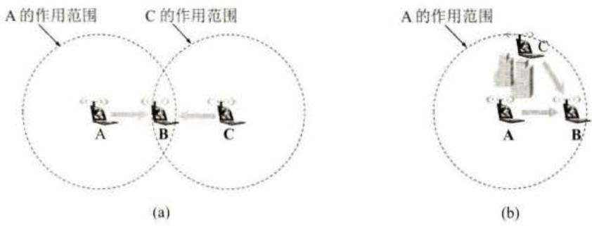
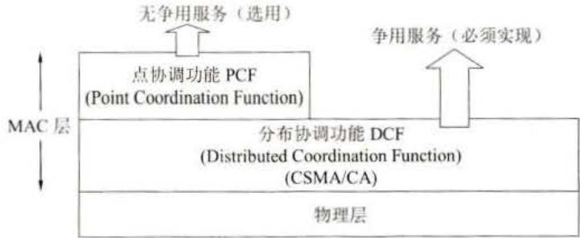
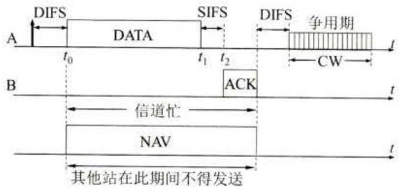
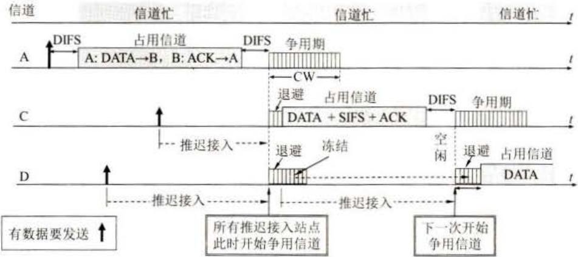
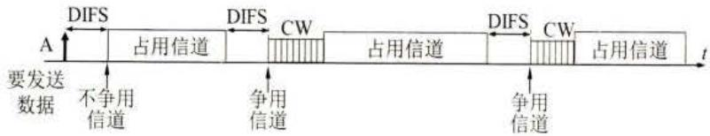
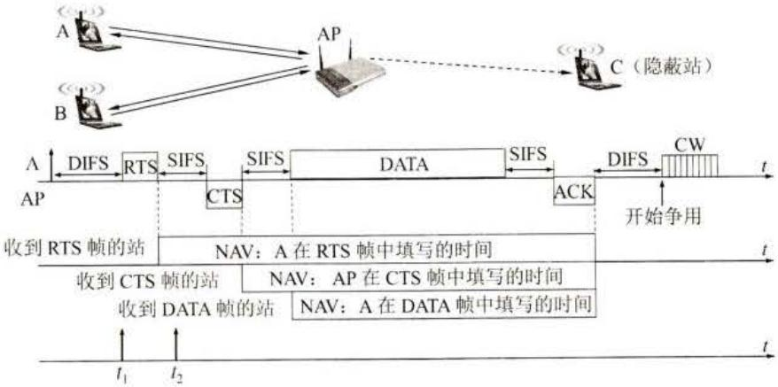

# 9.1.3 802.11局域网的MAC层协议

## 1. CSMA/CA 协议

虽然 CSMA/CD 协议已成功地应用于使用有线连接的局域网，但无线局域网能不能也使用 CSMA/CD 协议呢？下面我们从无线信道本身的特点出发来详细讨论这个问题。

“碰撞检测”要求一个站点在发送本站数据的同时，还必须不间断地检测信道。一旦检测到碰撞，就立即停止发送。但由于无线信道的传输条件特殊，其信号强度的动态范围非常大，因此在802.11适配器上接收到的信号强度往往会远远小于发送信号的强度（信号强度可能相差百万倍）。因此无线局域网的适配器无法实现碰撞检测。

> ① 注：在物理层使用的 OFDM 是 Orthogonal Frequency Division Multiplexing（正交频分复用）的缩写。MIMO 是 Multiple Input Multiple Output（多入多出）的缩写，即空间分集，使用多空间通道，即利用物理上完全分离的最多 4 个发射天线和 4 个接收天线，对不同数据进行不同的调制/解调，因而提高了数据的传输速率。

我们知道，无线电波能够向所有的方向传播，且其传播距离有限。当电磁波在传播过程中遇到障碍物时，其传播距离就会受到限制。如图 9-5 所示的例子就是无线局域网的隐蔽站问题。我们假定每个移动站的无线电信号传播范围都是以发送站为圆心的一个圆形面积。

> 图 9-5 A 和 C 同时向 B 发送数据，发生碰撞（教材第 413 页）

图 9-5(a) 表示站点 A 和 C 都想和 B 通信（这里仅仅是讲解隐蔽站问题的原理，在通信的过程中省略了接入点 AP。可以把 B 看成是接入点 AP）。但 A 和 C 相距较远，彼此都检测不到对方发送的信号。当 A 和 C 检测到信道空闲时，就都向 B 发送数据，结果发生了碰撞，并且无法检测出这种碰撞。这就是隐蔽站问题(hidden station problem)。所谓隐蔽站，就是它发送的信号检测不到，但却能产生碰撞。这里 C 是 A 的隐蔽站，A 也是 C 的隐蔽站。

当移动站之间有障碍物时也有可能出现上述问题。例如，图 9-5(b) 的三个站点 A, B 和 C 彼此距离都差不多。从距离上看，彼此都应当能够检测到对方发送的信号。但 A 和 C 之间有高楼或高山，因此 A 和 C 都互相成为对方的隐蔽站。若 A 和 C 同时向 B 发送数据就会发生碰撞，使 B 无法正常接收。此时也无法检测出碰撞。

综上所述，在制定无线局域网的协议时，必须考虑以下特点：

(1) 无线局域网的适配器无法实现碰撞检测；

(2) 检测到信道空闲，其实信道可能并不空闲；

(3) 即使我们能够在硬件上实现无线局域网的碰撞检测功能，也无法检测出隐蔽站问题带来的碰撞。

我们知道，CSMA/CD有两个要点。一是发送前先检测信道，信道忙就不发送。二是边发送边检测信道，一发现碰撞就立即停止发送，并执行退避算法进行重传。因此偶尔发生的碰撞并不会使局域网的运行效率降低很多。无线局域网显然可以使用CSMA，但无法使用碰撞检测（由上述无线局域网特点(1)和(3)决定的），一旦开始发送数据，就一定把整个帧发送完毕；一旦发生碰撞，整个信道资源的浪费就比较严重。

为此，802.11 局域网使用 CSMA/CA 协议 $^{①}$ 。CA 表示 Collision Avoidance，是碰撞避免的意思，或者说，协议的设计是要尽量减少碰撞发生的概率。这点和使用有线连接的以太网有很大的区别。以太网当然不希望发生碰撞，但并不怕发生碰撞，因为碰撞的影响并不大。

> ① 注：有的资料称这种协议为具有碰撞避免的多点接入 MACA (Multiple Access with Collision Avoidance)。

802.11 局域网在使用 CSMA/CA 的同时，还使用停止等待协议。这是因为无线信道的通信质量远不如有线信道的，因此无线站点每通过无线局域网发送完一帧后，要等到收到对方的确认帧后才能继续发送下一帧。这就是链路层确认。链路层确认也是解决碰撞后重传的手段。

我们在进一步讨论 CSMA/CA 协议之前，先要介绍 802.11 的 MAC 层。

802.11 标准设计了独特的 MAC 层（如图 9-6 所示）。它通过协调功能(Coordination Function)来确定在基本服务集 BSS 中的移动站，在什么时间能发送数据或接收数据。802.11 的 MAC 层在物理层的上面，它包括两个子层。

> 图9-6 802.11的MAC层（教材第 414 页）

(1) 分布协调功能 DCF (Distributed Coordination Function)。DCF 不采用任何中心控制，而是在每一个节点使用 CSMA 机制的分布式接入算法，让各个站通过争用信道来获取发送权。因此 DCF 向上提供争用服务。802.11 标准规定，所有的实现都必须有 DCF 功能。为此，定义了两个非常重要的时间间隔，即短帧间间隔 SIFS (Short Inter-Frame Spacing) 和分布协调功能帧间间隔 DIFS (DCF IFS)。关于这两个时间间隔后面还要讲到。802.11 标准还定义了其他几种时间间隔，这里从略。

(2) 点协调功能 PCF (Point Coordination Function)。PCF 是选项，是用接入点 AP 集中控制整个 BSS 内的活动，因此自组网络就没有 PCF 子层。PCF 使用集中控制的接入算法，用类似于探询的方法把发送数据权轮流交给各个站，从而避免了碰撞的产生。对于时间敏感的业务，如分组话音，就应使用提供无争用服务的点协调功能 PCF。

我们目前大量使用的无线局域网都是使用上述的分布协调功能 DCF。

CSMA/CA 协议比较复杂。IEEE 的 802.11-2007 标准文档共有 1232 页之多。这里介绍 CSMA/CA 协议的要点如下：

(1) 站点若想发送数据必须先监听信道。若信道在时间间隔 DIFS 内均为空闲，则发送整个数据帧。否则，进行(2)。

(2) 站点选择一随机数，设置退避计时器。计时器的运行规则是：若信道忙，则冻结退避计时器，继续等待，直至信道变为空闲（这叫作推迟接入）；若信道空闲，并在时间间隔DIFS内均为空闲，则开始争用信道，进行倒计时。当退避计时器的时间减到零时（显然这只能发生在信道空闲时），站点就发送数据帧，把一整帧发完。

(3) 站点若收到接收方发来的确认帧，且还有后续帧要发送，就转到(2)。若在设定时间内未收到确认，则准备重传，并转到(2)，但会在更大的范围内选择一随机数。

下面详细解释上述协议中的内容。

## 2. 时间间隔 DIFS 的重要性

在图 9-7 中，站点 A 要向站点 B 发送数据。A 监听信道。若信道在时间间隔 DIFS 内一直都是空闲的（理由下面就要讲到），A 就可以在 $t_{0}$ 时间发送数据帧 DATA。B 收到后立即发回确认 ACK。B 开始发送确认的时刻，实际上必然略滞后于 B 收完 DATA 的时间，滞后的时间是 SIFS。这是因为 B 收到数据帧后，必须进行 CRC 检验。若检验无差错，再从接收状态转为发送状态，这些动作不可能在瞬间完成。SIFS 值在 802.11 标准中均有规定。因此，从 A 发送数据帧 DATA 开始，到收到确认 ACK 为止的这段时间 (DATA + SIFS + ACK)，必须不允许任何其他站发送数据，这样才不会发生碰撞。为此，802.11 标准规定了每个站必须同时使用以下的两个方法。

> 图 9-7 A 向 B 发送数据，B 发回确认（教材第 415 页）

第一个方法是用软件实现的虚拟载波监听（Virtual Carrier Sense）的机制。这就是让源站 A 把要占用信道的时间（即 DATA + SIFS + ACK），以微秒为单位，写入其数据帧 DATA 的首部（在后面的 9.1.4 节还要介绍首部的各字段）。所有处在站点 A 的广播范围内的各站，都能够收到这一信息，并创建自己的网络分配向量 NAV (Network Allocation Vector)。NAV 指出了信道忙的持续时间，意思是：“A 和 B 以外的站点都不能在这段时间发送数据”。

第二个方法是在物理层用硬件实现载波监听。每个站检查收到的信号强度是否超过一定的门限数值，用此判断是否有其他移动站在信道上发送数据。任何站要发送数据之前，必须监听信道。只要监听到信道忙，就不能发送数据。

从图 9-7 可以看出， $t_{1}$ 至 $t_{2}$ 这段时间 SIFS，信道是空闲的。为了保证在这小段空闲时间不让其他站点发送数据，802.11 标准定义了比 SIFS 更长的时间间隔 DIFS (DCF IFS)，并且规定，凡在空闲时间想发送数据的站点，必须等待时间 DIFS 后才能发送。这就保证了确认帧 ACK 得以优先发送。这个重要措施使得在这段时间 $(\text{DATA} + \text{SIFS} + \text{ACK})$ ，整个信道好像是 A 和 B 专用的，因为其他站点暂时都不能发送数据。

## 3. 争用信道的过程

现假定在站点 A 和 B 通信的过程中，站点 C 和 D 也要发送数据（如图 9-8 所示）。但 C 和 D 检测到信道忙，因此必须推迟接入 (defer access)，以免发生碰撞。很明显，如果有两个或更多的站，在等待信道进入空闲状态后，大家都经过规定的时间间隔 DIFS 再同时发送数据，那么必然产生碰撞。因此，协议 CSMA/CA 规定，所有推迟接入的站，都必须在争用期执行统一的退避算法开始公平地争用信道。

> 图 9-8 在争用期根据退避算法公平竞争（教材第 416 页）

图 9-8 中的争用期也叫作争用窗口 CW (Contention Window)。争用窗口由许多时隙(time slot)组成。例如，争用窗口 CW = 15 表示窗口大小是 15 个时隙。时隙长度是这样确定的：在下一个时隙开始时，每个站点都能检测出在前一个时隙开始时信道是否忙（这样就可采取适当对策）。时隙的长短在不同 802.11 标准中可以有不同数值。例如，802.11g 规定一个时隙时间为 9 μs，SIFS = 10 μs，而 DIFS 应比 SIFS 的长度多两个时隙，因此 DIFS = 28 μs。

退避算法规定，站点在进入争用期时，应在0～CW个时隙中随机生成一个退避时隙数，并设置退避计时器(backoff timer)。当几个站同时争用信道时，计时器最先降为零的站，就首先接入媒体，发送数据帧。这时信道转为忙，而其他正在退避的站则冻结其计时器，保留计时器的数值不变，推迟到在下次争用信道时接着倒计时。这样的规定对所有的站是公平的。

例如，图 9-8 中的站点 C 的退避时隙数为 3，而站点 D 的退避时隙数为 9。当经过 3 个退避时隙后，站点 C 获得了发送权，立即发送数据帧，信道转为忙状态。站点 D 随即冻结其剩余的 6 个时隙，推迟到下一个争用信道时间的到来。如果此后没有其他站要发送数据，那么经过剩余的 6 个退避时隙，站点 D 就可以发送数据了。

请注意 “推迟接入” 和 “退避(backoff)” 的区别。推迟接入发生在信道处于忙的状态，为的是等待争用期的到来，以便执行退避算法来争用信道。这时退避计时器处于冻结状态。而退避是争用期各站点执行的算法，退避计时器进行倒计时。这时信道是空闲的，并且总是出现在时间间隔 DIFS 的后面（如图 9-8 所示）。

802.11 标准并未规定争用窗口 CW 的初始值，但建议 CW 最小值可取为 15，最大值为 1023。

为了减少碰撞的机会，协议 CSMA/CA 规定，如果未收到确认帧（可能是发生碰撞，或数据帧传输出差错），则必须重传。但每重传一次，争用窗口的数值就近似加倍增大。

例如，假定选择初始争用窗口 $CW = 2^{4} - 1 = 15$ ，那么首次争用信道时，随机退避时隙数应在 0～15 之间生成。在进行重传时，第 i 次重传的争用窗口 $CW = 2^{4 + i} - 1$ 。

第 1 次重传时，随机退避的时隙数应在 0～31 之间生成。

第 2 次重传时，随机退避的时隙数应在 0～63 之间生成。

第 3 次重传时，随机退避的时隙数应在 0～127 之间生成。

第 4 次重传时，随机退避的时隙数应在 0～511 之间生成。

第 5 次以及 5 次以上重传时，随机退避的时隙数应在 0～1023 之间生成，争用窗口 CW

不再增大了。

采用上面这些措施，发生几个站同时发送数据的概率可以大大减小。

归纳以上的讨论可以得出如下结论：当站点想发送数据，并检测信道连续空闲时间超过 DIFS 时，即可立即发送数据，而不必经过争用期。

在以下几种情况下，发送数据必须经过争用期的公平竞争：

(1) 要发送数据时检测到信道忙。

(2) 已发出的数据帧未收到确认，重传数据帧。

(3) 接着发送后续的数据帧。

上述的(3)是为了防止一个站长期垄断发送权。若一站点要连续发送若干数据帧，则不管有无其他站争用信道，都必须进入争用期（如图9-9所示）。

> 图 9-9 只有 A 站连续发送数据（教材第 417 页）

即使有了上述措施，碰撞仍有可能发生。例如，B站正好在图9-9中A占用信道时要发送数据。B检测到信道忙，于是推迟到争用信道时与A一起争用信道。但正巧A和B又生成了同样大小的随机退避时隙数。结果就发生了碰撞，A和B都必须再重传。这就浪费了宝贵的信道资源。因此，要进一步减少碰撞的机会，还需要再采用一些措施。这就是下面要介绍的信道预约。

## 4. 对信道进行预约

为了更好地解决隐蔽站带来的碰撞问题，802.11 允许要发送数据的站对信道进行预约。我们假定在图 9-10 中的 A 站要和 B 站通信。显然，A 站与 B 站的通信都必须通过接入点 AP 的转发。在前面图 9-7 和图 9-8 中讲解原理时，我们都把接入点 AP 省略了。下面我们要画出 A 站和 AP 之间交换的信息，但为简单起见，图中省略了 AP 和 B 站之间交换的信息。

我们再假定，A站或B站向接入点AP发送数据时，远处的C站接收不到这些信号，而C站向AP发送的信号也传播不到远处的A站或B站。

在 A 站向 AP 发送数据帧 DATA 之前，先发送一个很短的控制帧，叫作请求发送 RTS (Request To Send)，目的是告诉所有能够收到 RTS 帧的站：“我将要占用信道一段时间：[SIFS + CTS + SIFS + DATA + SIFS + ACK]”。这段时间写在控制帧 RTS 的首部中。A 站发送的 RTS 帧，B 站能够收到，但远处的 C 站收不到。

接入点 AP 若正确收到 RTS 帧，经过最短的时间间隔 SIFS 后，就向 A 站发送一个叫作允许发送 CTS (Clear To Send) 的控制帧，目的不仅是告诉 A 站：“你可以发送数据了”，而且也是告诉所有能够收到 CTS 帧的站：“A 站和我通信，要占用信道一段时间：[SIFS + DATA + SIFS + ACK]”。这段时间是写在控制帧 CTS 的首部中。AP 发送的 CTS 帧，A 站和 B 站以及 C 站都能够收到。

在随后 A 站发送的 DATA 帧的首部中，也写入了时间 [DATA + SIFS + ACK]。如果有的站没有收到 RTS 和 CTS 帧，那么收到 DATA 帧后，也能设置其 NAV。

以上措施就使得 A 站和接入点 AP（以及 A 站和 B 站）的通信过程中，发生碰撞的概

率大大降低，特别是减少了隐蔽站的干扰问题。

> 图 9-10 发送 RTS 帧和 CTS 帧对信道进行预约（教材第 418 页）

显然，增加使用 RTS 帧和 CTS 帧会使整个网络的通信效率有所下降，要多浪费信道的时间[RTS + SIFS + CTS + SIFS]。但由于这两种控制帧都很短，其长度分别为 20 字节和 14 字节，与数据帧（最长可达 2346 字节）相比开销不算大。相反，若不使用这种控制帧，则一旦发生碰撞而导致数据帧重发，浪费的时间就更多了。

从图 9-10 可以看出，即使我们使用 RTS 和 CTS 对信道进行了预约，但碰撞也有可能发生。例如，有的站可能在时间 $t_{1}$ 或 $t_{2}$ 就发送了数据（这些站可能是没有收到 RTS 帧或 CTS 帧或 NAV），结果必定与 RTS 帧或 CTS 帧发生碰撞。A 站若收不到 CTS 帧，就不能发送数据帧，而必须重传 RTS 帧。A 站只有正确收到 CTS 帧后才能发送数据帧。但我们可以看出，在使用信道预约的情况下，即使发生了碰撞，信道资源的浪费是很小的。

信道预约不是强制性规定。各站可以自己决定使用或不使用信道预约。看来，只有当数据帧的长度超过某一数值时，使用 RTS 帧和 CTS 帧才比较有利。

因为无线信道的误码率比有线信道的高得多，所以，无线局域网的 MAC 帧长一般应当短些，以便在出错重传时减小开销。这样，有时就必须将太长的帧进行分片。

最后，我们要提一下关于无线局域网的数据发送速率问题。在第2章的2.3.2节的图2-13中，已经指出无线信道中的误码率与信噪比（信道状况）以及所选择的调制技术（包括数据率）有关。802.11标准并没有对无线局域网数据率的自适应算法有具体的标准或规定。但生产无线局域网适配器的厂商，一般都使自己的产品能够自适应地改变数据率，以便更好地适应信道特性的变化。例如，可以采用这样的算法：如果一连发送两个数据帧但都没有收到确认，就认为信道的质量较差，这时就把数据率调慢一挡。反之，如果此后又能够连续收到10个数据帧的确认，那么就可以认为信道质量改善了，因而可以把数据率调快一挡。这与协议TCP中的拥塞控制的处理思路是相似的。
