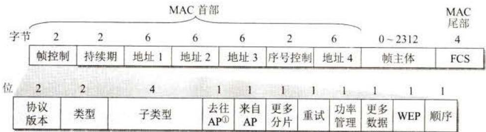
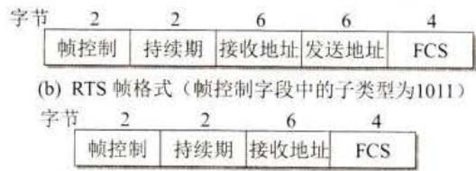
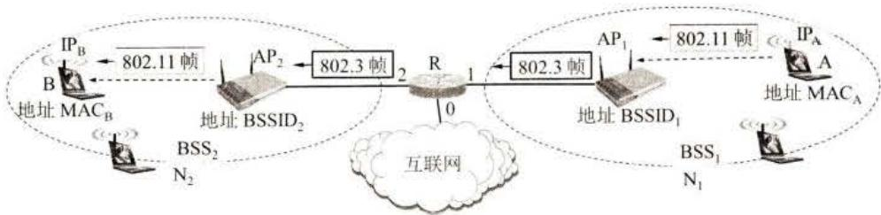
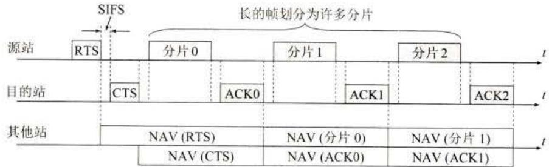

# 9.1.4 802.11局域网的MAC帧

为了更好地了解 802.11 局域网的工作原理，我们应当进一步了解 802.11 局域网的 MAC 帧的结构。802.11 帧共有三种类型，即控制帧、数据帧和管理帧。通过图 9-11 所示的 802.11 局域网的数据帧和三种控制帧的主要字段，可以进一步了解 802.11 局域网的 MAC 帧的特点。

从图 9-11(a) 可以看出，802.11 数据帧由以下三大部分组成：

> (a) 数据帧格式（帧控制字段中的子类型为0000） (c) CTS 和 ACK 帧格式（帧控制字段中的子类型分别为 1100 和 1101） 图 9-11 802.11 局域网的帧格式（教材第 419 页）

(1) MAC 首部，共 30 字节。帧的复杂性都在帧的 MAC 首部。

(2) 帧主体，也就是帧的数据部分，不超过 2312 字节。这个数值比以太网的最大长度长很多。不过 802.11 帧的长度通常都小于 1500 字节。

(3) 帧检验序列 FCS 是 MAC 尾部，共 4 字节。

## 1. 关于 802.11 数据帧的地址

802.11 数据帧最特殊的地方就是有四个地址字段。这几个地址与帧控制字段中的“去往AP”（移动站发送到接入点）和“来自AP”（从接入点发往移动站）这两个子字段的数值有关。

地址 1 永远是接收地址（即直接接收数据帧的节点地址）。

地址 2 永远是发送地址（即实际发送数据帧的节点地址）。

地址 3 和地址 4 取决于数据帧中的 “来自 AP” 和 “去往 AP” 这两个字段的数值。

这里要再强调一下，上述地址都是 MAC 地址，即硬件地址（在数据链路层不可能使用 IP 地址），而 AP 的 MAC 地址就是在 9.1.1 节介绍的 BSSID。表 9-2 给出了 802.11 帧的地址字段最常用的两种情况（在有基础设施的网络中一般只使用前三种地址，很少使用仅在自组移动网络中使用的地址 4）。

> 表 9-2 802.11 帧的地址字段最常用的两种情况（教材第 419 页）

| 去往 AP | 来自 AP | 地址 1 | 地址 2 | 地址 3 | 地址 4 |
| --- | --- | --- | --- | --- | --- |
| 0 | 1 | 接收地址 = 目的地址 | 发送地址 = AP 地址 | 源地址 | —— |
| 1 | 0 | 接收地址 = AP 地址 | 发送地址 = 源地址 | 日的地址 | —— |

> ① 注：802.11 标准上使用的名词是分配系统 DS，但在解释中，指出这里的 DS 也包含接入点 AP。因此我们在这里使用接入点 AP 代替 DS。

现假定在一个基本服务集中的站点 A 向站点 B 发送数据帧。在站点 A 发往接入点 AP 的数据帧的帧控制字段中，“去往 AP = 1”而“来自 AP = 0”。

A→AP 的数据帧首部:

地址 1：接收地址（不是目的地址）是 AP 的地址 BSSID。

地址 2：发送地址，即源地址，也就是站点 A 的地址 MAC $_{A}$ 。

地址 3：目的地址（不是接收地址）是站点 B 的地址 MAC $_{B}$ 。

接入点 AP 收到数据帧后，转发给站点 B，但在数据帧的帧控制字段中，“去往 AP = 0”而“来自 AP = 1”。

AP→B 的数据帧首部:

地址 1：接收地址就是目的地址 $MAC_{B}$ 。

地址 2：发送地址（不是源地址）是接入点 AP 的地址 BSSID。

地址 3：源地址（不是发送地址）是站点 A 的地址 MAC $_{A}$ 。

下面讨论另一种稍复杂些的情况，即站点 A 向站点 B 发送数据帧（如图 9-12 所示）。现在 A 和 B 分别处在不同的两个子网 $N_{1}$ 和 $N_{2}$ 中，因此在网络层看，是地址为 $IP_{A}$ 的站点 A，把 IP 数据报从子网 $N_{1}$ 经过路由器 R 转发到子网 $N_{2}$ 。在网络层看不见链路层的接入点 $AP_{1}$ 和 $AP_{2}$ 。IP 数据报必须装入链路层的帧才能在链路层发送。但链路层不认识 IP 地址，只认识 MAC 地址，即硬件地址。站点 A 使用协议 ARP 获得了默认路由器 R 的接口 1 的地址 $MAC_{R-1}$ 。这样，站点 A 先把 802.11 数据帧发到接入点 $AP_{1}$ ，然后 $AP_{1}$ 把 802.11 帧转换为 802.3 帧，发送到路由器 R 的接口 1。站点 A 发送的 802.11 帧的帧控制字段中，“去往 AP = 1”而“来自 AP = 0”。

$A \rightarrow AP_{1}$ 的 802.11 数据帧首部：

地址 1: 接收地址（不是目的地址）是 AP $_{1}$ 的地址 BSSID $_{1}$ 。

地址 2：发送地址，即源地址，也就是站点 A 的地址 MAC $_{A}$ 。

地址 3：目的地址（不是接收地址）是本子网中路由器 R 接口 1 的地址 MAC $_{R-1}$ 。

> 图 9-12 链路上的 802.11 帧和 802.3 帧（教材第 420 页）

当接入点 $AP_{1}$ 收到 802.11 数据帧后，就转换成 802.3 帧（802.3 帧只有两个地址），其目的地址是 $MAC_{R-1}$ ，而源地址是 $MAC_{A}$ （而不是接入点 $AP_{1}$ 的地址 $BSSID_{1}$ ）。

路由器 R 收到 802.3 帧后，剥去首部和尾部，上交给网络层。网络层根据 IP 数据报首部中的目的地址 $IP_{B}$ 查找转发表，知道应从接口 2 转发给地址为 $IP_{B}$ 的设备。再使用协议 ARP，获得此设备的硬件地址是 $MAC_{B}$ ，这个地址就是 802.3 帧的目的地址，路由器 R 接口 2 的地址 $MAC_{R-2}$ 是这个 802.3 帧的源地址。

接入点 $AP_{2}$ 收到 802.3 帧，将其转换为 802.11 帧，其帧控制字段中，“去往 AP = 0”而“来自 AP = 1”。

$AP_{2}\rightarrow B$ 的 802.11 帧首部：

地址 1: 接收地址（即目的地址）是站点 B 的地址 MAC $_{B}$ 。

地址 2: 发送地址是 AP₂ 的地址 BSSID₂。

地址 3：源地址（不是发送地址）是路由器 R 接口 2 的地址 MAC $_{R-2}$ 。

## 2. 序号控制字段、持续期字段和帧控制字段

下面再介绍 802.11 数据帧中其他的一些字段。

(1) 序号控制字段占 16 位, 其中序号子字段占 12 位 (从 0 开始, 每发送一个新帧就加 1, 到 4095 后再回到 0), 分片子字段占 4 位 (不分片则保持为 0。如分片, 则帧的序号子字段保持不变, 而分片子字段从 0 开始, 每个分片加 1, 最多到 15)。重传的帧的序号和分片子字段的值都不变。序号控制的作用是使接收方能够区分开是新传送的帧还是因出现差错而重传的帧。这和运输层讨论的序号的概念是相似的。

(2) 持续期字段占 16 位。在 9.1.3 小节第 4 部分 “对信道进行预约” 中已经讲过 CSMA/CA 协议允许发送数据的站点预约信道一段时间（见前面的图 9-10 的例子），并把这个时间写入到持续期字段中。这个字段有多种用途（这里不对这些用途进行详细的说明），只有最高位为 0 时才表示持续期。这样，持续期不能超过 $2^{15} - 1 = 32767$ ，单位是微秒。

(3) 帧控制字段共分为 11 个子字段。下面介绍其中较为重要的几个。

协议版本字段现在是0。

类型字段和子类型字段用来区分帧的功能。上面已经讲过，802.11帧共有三种类型：控制帧、数据帧和管理帧，而每一种帧又分为若干种子类型。例如，控制帧有RTS, CTS和ACK等几种不同的子类型。控制帧的几种常用的帧格式如图9-11(b)和(c)所示。

更多分片字段置为 1 时表明这个帧属于一个帧的多个分片之一。我们知道，无线信道的通信质量是较差的。因此无线局域网的数据帧不宜太长。当帧长为 n 而误比特率 $p = 10^{-4}$ 时，正确收到这个帧的概率 $P = (1 - p)^{n}$ 。若 n = 12144 bit（相当于 1518 字节长的以太网帧），则算出这时 P = 0.2969，即正确收到这样的帧的概率还不到 30%。因此，为了提高传输效率，在信道质量较差时，需要把一个较长的帧划分为许多较短的分片。这时可以在一次使用 RTS 和 CTS 帧预约信道后连续发送这些分片。当然这仍然要使用停止等待协议，即发送一个分片，等收到确认后再发送下一个分片，不过后面的分片都不需要用 RTS 和 CTS 帧重新预约信道（如图 9-13 所示）。

> 图 9-13 分片的发送（教材第 421 页）

功率管理字段只有 1 位，用来指示移动站的功率管理模式。我们知道，移动站的功率是其非常宝贵的资源。移动站在活跃状态时（即发送或接收信息）需要消耗功率，而在关机状态虽然不消耗功率，但却可能漏掉重要信息的接收。因此我们需要有第三种状态，这就是待机状态，或省电状态。这时移动站不进行任何实质性操作，屏幕也处于断电状态，但并未断开与 AP 的关联，因此这种状态非常省电。若一个移动站在发送给接入点 AP 的 MAC 帧中的功率管理字段置为 0，就表示这个移动站是处于活跃状态。但若把功率管理字段置为 1，则表示在成功发送完这一帧后，即进入待机状态。由于接入点 AP 总是处在活跃状态，因此 AP 发送的 MAC 帧的功率管理字段总是置为 0。

接入点 AP 保存有处在待机状态的移动站的名单。所有要发送给待机状态的移动站的帧，AP 都暂时不发送，而是保存在自己的缓存中。由于 AP 要周期性地向周围的移动站发送信标帧（通常是每隔 100 ms 发送一次），因此每个要转为待机状态的移动站都必须设置一个计时器，为的是在 AP 即将发送信标帧时，把处在待机状态的移动站唤醒，以便接收 AP 发来的信标帧。唤醒时间很短，仅 0.25 ms。AP 发送的信标帧中有帧被缓存在 AP 中的节点列表。若移动站从收到的信标帧中发现有发给自己的帧，就向 AP 发送请求把缓存的帧发过来。反之，若发现没有发给自己的帧，就再返回到待机状态。这样，若移动站既不发送也不接收数据帧，就可以有 99% 的时间处在待机状态，因而大大地减少了电池功率的消耗。

WEP字段占1位。若 $\mathrm{WEP} = 1$ ，就表明对MAC帧的帧主体字段采用了加密算法。我们已经在9.1.1节指出，WEP加密算法有安全漏洞。因此，IEEE802.11i就努力解决无线局域网的安全问题。2002年Wi-Fi联盟制定了符合802.11i功能的加密方式WPA。2004年制定的WPA2增加了支持AES加密算法，并完全符合IEEE802.11i-2004的安全功能。现在的Wi-Fi产品几乎都支持WPA2。但在MAC帧首部的帧控制字段中，WEP字段的名称仍继续使用（已发现有的文献把WEP字段改为被保护帧(Protected Frame)字段，但字段的作用不变）。WPA2的加密算法相当复杂[KURO17]，限于篇幅，这里从略。
