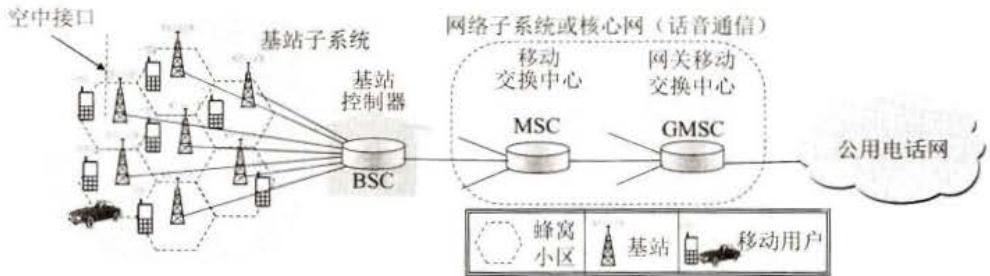
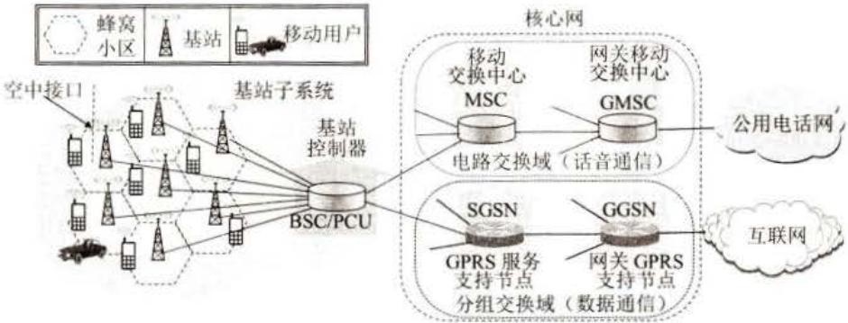
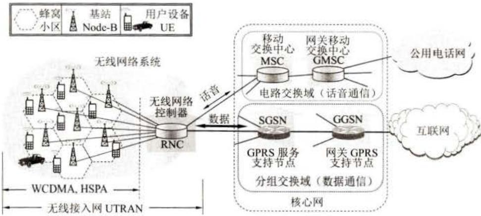
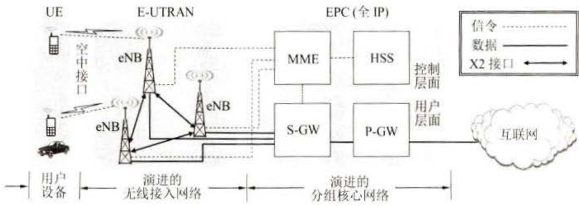

# 9.3.1 蜂窝无线通信技术的发展简介

## 9.3 蜂窝移动通信网

## 1. 蜂窝移动通信系统问世

移动通信的种类很多，如蜂窝移动通信、卫星移动通信、集群移动通信、无绳电话通信等，但目前使用最多的是蜂窝移动通信，它又称为小区制移动通信。

蜂窝无线通信网发展非常迅速，其信号的覆盖面已远远超过 Wi-Fi 无线局域网的覆盖面。蜂窝无线通信最初只是用来打电话，这和本书讨论的计算机网络并无关联。但随着技术的发展，原来仅用来进行电话通信的手机，已经发展成为接入到互联网最主要的用户设备。手机之间互相传送的数据（其中大量是视频、音频数据）已构成当今互联网上流量的主要成分。现在若要在移动的环境下接入到互联网已经离不开蜂窝无线通信网了。

> ① 注：消费电子设备 CE (Consumer Electronics) 指电视机、数码相机、数码摄像机、MP3 播放器等电子设备。在这些设备之间快速传送数据的需求促进了无线个人区域网的发展。

蜂窝无线通信技术相当复杂，要深入了解其工作原理，需要学习另外的课程。因此本节的重点仅限于介绍两种网络（蜂窝移动通信网和互联网）怎样相互连接。为此，对蜂窝移动通信网必须有最低限度的入门介绍。初学者往往不熟悉大量的英文缩写词（但这些都是在技术文献中普遍使用的）。在遇到生疏的缩写词时，最好的办法就是反复多看几遍。

最早的第一代(1G)蜂窝移动通信系统于 1978 年底问世，它使用模拟技术和传统的电路交换及频分多址 FDMA 提供电话服务。这里的 G 表示 Generation（代），而不是 Giga（千兆，或吉）。1G 移动通信系统的手机相当笨重（俗称大哥大），且话音质量差，因此不久后就被第二代(2G)蜂窝移动通信系统取代了。

## 2. 2G 蜂窝移动通信系统

1990 年后开始了基于数字技术的第二代(2G)蜂窝移动通信，其代表性体制就是欧洲提出的 GSM 系统。虽然许多国家现在已经停止使用 2G 系统了，但为了更好地了解 3G 和 4G 体制，这里有必要非常简单地介绍一下 GSM 2G 蜂窝通信系统的重要组成构件（还有另外一种也属于 2G 蜂窝移动通信的 CDMA，这里从略）。

如图 9-17 所示，蜂窝移动通信的特点是把整个网络服务区划分成许多小区（cell，也就是“蜂窝”），每个小区设置一个基站，负责与本小区各个移动站的联络和控制。小区也就是基站的覆盖区。移动站的发送或接收都必须经过基站完成，因此基站又称为收发基站。每个基站的发射功率既要能够覆盖本小区，又不能太大以致干扰了邻近小区的通信。小区的大小视基站天线高度、增益和信号传播条件以及该小区内的移动用户密度而定，从半径 20 m （移动用户很密集的地方）到 1\~25 km 不等。采用小区的好处是可以在相隔一定距离的小区中重复使用相同的频率，这称为频率复用。图 9-17 画出了 7 个小区，每个小区的基站使用不同的频率。这样，只要相邻小区采用不同的频率，就可以组成由大量小区构成的蜂窝无线通信系统。实际的小区因受地形的限制，并非严格的六边形。之所以画成六边形的小区是为了更好地说明采用蜂窝技术怎样解决了同频干扰以及频率重复使用的问题。这样，用一个个相互拼接的六边形的小区，就可组成覆盖面积很大的蜂窝无线通信系统。

> 图 9-17 2G GSM 蜂窝通信系统的重要组成构件（教材第 426 页）

GSM 系统虽然使用了数字技术，但仍然使用传统的电路交换提供基本的话音通信服务。移动用户到基站之间的空口（即无线空中接口）采用的多址方式是 FDMA/TDMA 的混合系统。这种混合系统先按频分复用方式，把可用频带（上行和下行各占用 25 MHz）划分为 125 个带宽为 200 kHz 的子频带。然后再把每个子频带进行时分复用，每个 TDM 帧划分为

8 个时隙，使每个通话的用户占用一个 TDM 帧中的一个特定时隙。在每个蜂窝内可以从 $125 \times 8$ 个频道中合理地挑选出一些频道，就可以使相隔一定距离的蜂窝能够重复使用相同频率的频道。在移动通信系统中，“上行”是指从移动站到基站，而“下行”是指从基站到移动站。

如图 9-17 所示，GSM 包括基站子系统和网络子系统（常称为核心网）。基站子系统包括几十个基站和一个基站控制器 BSC (Base Station Controller)。基站控制器 BSC 为基站子系统中的几十个基站服务。当基站系统中的移动用户和基站进行通信时，基站控制器 BSC 要负责为其分配无线信道，确定移动用户所在的小区，并当移动用户在基站子系统内漫游时进行信道的切换。

核心网包括移动交换中心 MSC (Mobile Switching Center) 和网关移动交换中心 GMSC (Gateway Mobile Switching Center)。MSC 的重要任务是负责用户的授权和账单（即确定是否允许一个移动设备接入到这个蜂窝网络中），用户呼叫连接的建立和释放，以及当用户移动在不同的基站子系统之间漫游时的信道切换。通常一个移动交换中心 MSC 可以管理 5 个基站控制器 BSC，而移动通信运营商可以建立很多的 MSC，然后通过网关移动交换中心 GMSC，连接到公用电话网或其他移动通信网。GSM 的数据率仅为 9.6 kbit/s，要连接到互联网浏览网页是很不合适的。不过 GSM 可通过其信令系统提供字数不多的短信服务。

在图 9-17 中，我们省略了相当复杂的信令系统的构件。我们使用手机通话之前的拨号，就是靠信令系统来准确找到被叫用户的。整个蜂窝移动通信系统的管理和维护都要依靠复杂的信令系统。

## 3. 数据通信被引入移动通信系统

GSM 初期以提供话音为主，在中后期为了满足移动数据通信需求，引入通用分组无线服务 GPRS (General Packet Radio Service)（俗称 2.5G）和增强型数据速率 GSM 演进 EDGE (Enhanced Data rate for GSM Evolution)（俗称 2.75G）系统，除了在空口调制方式由高斯最小频移键控 GMSK (Gaussian Minimum Shift Keying) 提高到 8PSK 外，网元方面引入了分组控制单元 PCU (Packet Control Unit)，PCU 通常和 BSC 集成在一起，负责处理有关数据通信的业务。PCU 根据用户数据业务的突发性质，动态地分配空口资源给用户，提高了空口资源的利用率，提供的最大速率为 171.2 kbit/s（GPRS）和 384 kbit/s（EDGE）。

引入 GPRS 后的核心网由两个不同性质的域组成，即电路交换域和分组交换域（如图 9-18 所示）。电路交换域就是原来 GSM 的核心网部分，而分组交换域则包括服务 GPRS 支持节点 SGSN (Serving GPRS Support Node) 和网关 GPRS 支持节点 GGSN (Gateway GPRS Support Node)。电路交换域负责话音通信，而分组交换域负责数据通信。SGSN 把基站控制器发来的 IP 数据报发送到 GGSN，同时把 GGSN 发来的 IP 数据报转发到基站控制器。SGSN 还要和蜂窝话音核心网的移动交换中心 MSC 交互，以便完成用户的授权、通信的切换，以及维护移动节点的位置信息等功能。GGSN 具有网络接入控制功能，把多个 SGSN 连接起来后接入到互联网。因此 GGSN 又称为 GPRS 路由器，它选择哪些分组可进入 GPRS 网络，以保证 GPRS 网络的安全。

> 图 9-18 引入 GPRS 后的核心网由电路交换域和分组交换域组成（教材第 428 页）

## 4. 3G蜂窝移动通信系统

1996 年国际电联无线电通信部门 ITU-R 把第三代(3G)蜂窝移动通信的正式标准名称定为 IMT-2000，希望全球能够制定出一个统一的标准（但实际上未能统一）。名称中的 2000 表示：这个系统工作在 2000 MHz 频段，支持的数据率可达 2000 kbit/s（固定站）和 384 kbit/s（移动站），并预期在 2000 年左右得到商用。下面介绍 IMT-2000 中最广泛使用的一种标准。

1998 年全球在通信领域最有影响的 7 个组织，其中包括中国通信标准化协会 CCSA (China Communications Standards Association)，成立了第三代移动通信合作伙伴计划 3GPP (3rd Generation Partnership Project)，以便制定从 2G GSM 平滑过渡到 3G 的端到端标准。3GPP 制定的 3G 标准名称是通用移动通信系统 UMTS (Universal Mobile Telecommunications System)，发布在 3GPP R99 中。R99 (Release 99) 表示这是 3GPP 规范的 1999 年版本。但在 2000 年以后，版本的格式改变了，字母 R 后面的数字表示 3GPP 规范的版本顺序号。3GPP R99 版本对 UMTS 的要求是，下行和上行的数据率都要超过 384 kbit/s。

3G UMTS 引入了无线接入网的概念（如图 9-19 所示），其全名是通用移动通信系统陆地无线接入网 UTRAN (UMTS Terrestrial Radio Access Network)，它由多个无线网络系统组成。每个无线网络系统有一个无线网络控制器 RNC (Radio Network Controller) 和许多基站，但在 UMTS 中，基站的正式名称是节点 B (Node-B)，简写为 NB。UTRAN 中无线网络控制器 RNC 的作用和 GSM 网络中的基站控制器相似。RNC 一方面通过电路交换域的 MSC 连接到的蜂窝话音网络，另一方面通过分组交换域的 SGSN 和 GGSN 连接到分组交换的互联网。3G UMTS 把移动站称为用户设备 UE (User Equipment)。在用户设备 UE 和基站 NB 之间是无线链路，这点和 2G 的情况是相似的。

3G 中的核心网由 GSM 系统中 GPRS 核心网进行平滑演进（软件升级和部分硬件升级）。在实际运营中还采用融合设备实现，例如，SGSN 和 GGSN 设备同时支持 2G/3G 功能。从互联网无法看到 GGSN 以内 3G 节点的移动性，GGSN 把这些对 UMTS 的外部都隐藏了。

> ① 注：ITU 是联合国下属的各国政府之间的组织，按理说，ITU 制定的标准应具有相当的权威性。但毕竟 ITU 并非专业技术性很强的组织，而且标准制定经历的时间往往拖得很长，因此许多标准的具体制定，还要依靠一些非政府机构的组织来完成。例如，有关互联网的标准，主要由 IETF 来制定。3GPP 的名称并不表示其研究对象仅限于 3G 蜂窝移动通信系统。目前全世界最主要的数百家移动通信网络运营商、芯片制造商、学术界、研究机构和政府机构，都积极参与了 3GPP 各种标准的制定。实际上，现在的 3GPP 远远不是局限于 3G 标准的制定，而是进行从 4G 一直到 5G 系统标准的制定。

3G UMTS 与 2G 的 GSM 的主要区别集中在 UTRAN 侧，在空口使用直接序列宽带码分多址 DS-WCDMA (Direct Sequence Wideband CDMA)，或时分同步码分多址 TD-SCDMA (Time Division-Synchronous Code Division Multiple Access)。这样，每个移动用户使用的带宽比 GSM 的增大很多，因而能以更高的数据率享用多种移动宽带多媒体业务（浏览网页，传送高清图片和视频短片，即时视频通信，进行多方视频会议等）。3G UMTS 也不断提高数据率，例如，WCDMA 引入高速分组接入增强型版本 HSPA+ (High Speed Packet Access+) 来传输数据后，其下行数据率可达到 21 Mbit/s（5 MHz 带宽），大大超过了 3G 最初设定的指标。

> 图 9-19 3G UMTS 蜂窝通信系统的重要组成构件（教材第 429 页）

我国现使用三种 3G 国际标准，即 3GPP 组织中由欧洲提出的宽带码分多址 WCDMA (Wideband CDMA)（UMTS 的标准，中国联通使用），3GPP 组织中由美国提出的 CDMA2000（中国电信使用）和 3GPP 组织中主要由中国提出的时分同步码分多址 TD-SCDMA (Time Division-Synchronous CDMA)（UMTS 标准，中国移动使用），其中 TD-SCDMA 和 WCDMA 使用相同的 3GPP 规范，仅在接入网空口部分有差异。3GPP 组织的 CDMA2000 系统的核心网及接入网与 TD-SCDMA/WCDMA 的都不同。

3G蜂窝移动通信是以传输多媒体数据业务为主的通信系统，而且必须兼容2G的功能（即能够通电话和发送短信），这就是所谓的向后兼容。

## 5. 4G蜂窝移动通信系统

ITU-R 于 2008 年把第四代(4G)移动通信的名称定为 IMT-Advanced (International Mobile Telecommunications-Advanced)，意思是高级国际移动通信。IMT-Advanced 的一个最重要的特点就是取消了电路交换，无论传送数据还是传送话音，全部使用分组交换技术，或称为全网 IP 化。IMT-Advanced 的目标峰值数据率是：固定的和低速移动通信时应达到 1 Gbit/s，在高速移动通信时（如在火车、汽车上）应达到 100 Mbit/s。不断提高数据率的动力来自客观的需求。智能手机的用户迫切需要利用手机上安装的即时通信应用软件，把他们用手机拍摄的视频短片或高清照片及时分享给自己的亲友，或用视频会议方式和亲友们进行视频交谈。这就要求移动通信系统把网络数据率再提高到新的水平。

ITU-R 提出的这个 4G 标准比 3G 的标准高出很多。在当时的技术条件下，各国的电信企业都很难实现这个 4G 标准。3GPP R8 版本发布的长期演进 LTE (Long-Term Evolution) 标准，在信道带宽为 20 MHz 时，其下行和上行数据率应分别达到 100 Mbit/s 和 50 Mbit/s。这虽然比 3G 快得多，但仍达不到 4G 的标准。为照顾许多商家的经济利益，经协商，ITU-R 同意运行 LTE 标准的商家在手机左上角显示 “4G” 的字样。但实际上 LTE 并不是真正的 4G。因此就有许多人把 LTE 俗称为 3.9G 或 3.95G，表示 LTE 已很接近 4G 了。

图 9-20 是 LTE 体系结构的最主要部分的简图。下面进行简单的讨论。

> 图 9-20 LTE 体系结构的简图（教材第 430 页）

LTE 的体系结构由三大部分组成，即用户设备 UE、演进的无线接入网 E-UTRAN (Evolved-UTRAN) 和演进的分组核心网 EPC (Evolved Packet Core)。从图 9-20 可看出，核心网 EPC 的用户层面和控制层面的划分非常清晰。图中 EPC 的上半部分是控制层面，下半部分是用户层面。信令的传输在图中用虚线表示，而用户数据的传输用实线表示。在移动通信领域经常提到的“用户层面”，就是我们在第 4 章中介绍的“数据层面”。

为了进一步提高数据率，LTE采用了以下的一些方法。

我们知道 3G 的 UMTS 的空口使用的是 WCDMA。如果 LTE 继续使用 WCDMA，那么就很难再提高数据传输的速率。现在 LTE 无线接入网的下行信道（eNB→UE）与上行信道（UE→eNB）采用了不同的复用方式。例如，下行信道采用了频分复用与时分复用相结合的方式，称为正交频分多址 OFDMA。我们知道，在传统的频分复用 FDM 中的各频道必须相隔一定的保护频带，以免相互干扰。但正交频分复用 OFDM 技术采用了多个子载波并行传输的方法，利用各子载波之间的正交性，子信道的频谱可以相互重叠，但在解调时并不产生子载波间干扰。这就大大提高了频谱利用率。OFDM 使每个子信道的数据率降低，因而有效地减少了由多径效应带来的符号间干扰，降低了误比特率。由于每个用户同时采用多个子信道并行传输，因此仍然能够获得较高的数据率。因而现在 LTE 的空口使用的带宽是 20 MHz，比 3G 的 UMTS 空口带宽 5 MHz 提高了很多。LTE 的用户设备发送的帧长为 10 ms，每个帧划分为 20 个时隙。因此一个时隙为 0.5 ms。LTE 每个被激活的用户设备可以被分配到一个或多个信道频率中的一个或多个时隙。用户设备分配到的时隙数越多（不管是在同一频率或在不同频率），就可以获得越高的数据率。在用户设备之间重新分配时隙的频度可以是每毫秒进行一次。

LTE 采用了高阶调制 64QAM，也就是让 1 码元携带 6 bit 的信息量。LTE 还采用了多天线的多入多出 MIMO 技术，这些措施对提高数据率和信道频谱利用率起了重要作用。

演进的无线接入网 E-UTRAN 与 3G 的 UTRAN 有很大的区别。E-UTRAN 取消了无线网络控制器 RNC，并把基站称为演进的节点 B，简写为 eNB (evolved Node-B)。LTE 的基站eNB 兼有 3G 中的基站 NB 和无线网络控制器 RNC 的功能，是 LTE 中功能最复杂的设备。在 E-UTRAN 中的基站 eNB，通过图 9-20 所示的 X2 接口，与相邻的一些基站相互连接，直接传输数据和信令（在 LTE 中，包括 3G 和 2G 在内，所有需要进行通信的实体之间，都有非常明确的接口规定，上述的 X2 接口仅是许多接口中的一个）。这样就便于用户设备漫游时的信号切换。E-UTRAN 采用这种减少节点层次的扁平结构，是为了简化接入网的结构和降低成本，同时也加快数据的传输。

基站 eNB 有三个主要构件。(1) 天线。(2) 无线模块：对发往空口的信号，或从空口接收的信号，进行调制或解调。(3) 数字模块：作为空口与核心网的接口，对经过此模块的所有信号进行处理。

在控制层面，基站 eNB 负责无线资源的管理，执行由 MME 发起的寻呼信息的调度和传输，并为 UE 发往服务网关 S-GW 的数据选择路由。

在数据层面中，基站 eNB 在用户设备 UE 与核心网之间传送 IP 数据报。

分组数据网络网关（简称为分组网关）P-GW (Packet Data Network GateWay)是核心网通向互联网的网关路由器或边界路由器，由 GGSN 平滑演进升级而来，是核心网与 3GPP 或非 3GPP 的外部数据网的接口。在现实网络中，2G/3G 的 GGSN 和 4G 的 P-GW 是一个融合设备。P-GW 也是核心网对外的锚点(Anchor point)。P-GW 负责给所有用户设备 UE 分配 IP 地址和确保服务质量 QoS 的实施。用户设备 UE 的数据报在基站 eNB 封装到 GTP-U 隧道中（后面还要讨论这个问题），通过全 IP 核心网 EPC，从 eNB 先到达 S-GW，再到达 P-GW。这种隧道方式还有保证服务质量 QoS 的作用。例如，LTE 网络可保证在 UE 到 P-GW 之间的话音分组时延不超过 100 ms，且话音分组的丢失率小于 1%。这就保证了在全 IP 网络传输时，话音通信的质量仍较好。在 LTE 的网络中不再保留电路交换的原因是，现在移动通信流量中的主流已是数据通信（如用手机浏览网页，阅读微信，利用微信进行音频或视频通信等）。为少量的手机电话通信业务而保留电路交换的构件，将使网络变得更加复杂，会大大增加网络的建设成本和运行费用。采用全 IP 网络是 LTE 网络结构中的一个重大变革。

服务网关 S-GW (Serving GateWay) 是无线接入网与核心网之间的网关路由器，由 SGSN 演进而来。在现实网络中，2G/3G 的 SGSN 和 4G 的 S-GW 是一个融合设备。S-GW 负责用户层面的数据分组的转发和路由选择，起到路由器的作用。S-GW 还负责 eNB 到 S-GW 以及 S-GW 到 P-GW 的隧道管理。S-GW 是数据层面中移动性的锚点。用户设备 UE 在通信过程中，可能会在 LTE 系统不同的 eNB 之间切换或漫游到 3GPP 的不同接入系统中（如 2G 的 GSM 或 3G 的 UMTS），如果这些 eNB 以及 2G/3G 的基站都与某一个 S-GW 连接，这时 UE 所关联的 S-GW 不变，数据流都从同一个 S-GW 流出，再转发到 P-GW。

SGW 和 PGW 可以在同一个物理节点或不同物理节点实现。

归属用户服务器 HSS (Home Subscriber Server) 是一个中心数据库，里面有网络运营商所保存的用户基本数据。

移动性管理实体 MME (Mobility Management Entity) 是一个信令实体，负责基站与核心网之间以及用户与核心网之间的所有信令交换。大的核心网需要有多个 MME 来处理大量的信令交换。当一个用户初次接入到 LTE 网络时，基站 eNB 就要与 MME 通信，以便 MME 和用户能够交换鉴别信息。MME 必须从 HSS 获得用户的有关信息。

在图 9-20 中还省略了一些构件，如策略与计费规则功能 PCRF (Policy and Charging Rules Function) 单元等，这里就不进行介绍了。

LTE 必须向后兼容 3G 和 2G。因此很多手机都标明具有 4G/3G/2G 功能。这表示如果 LTE 手机所在地还没有被 4G 网络覆盖，那么该手机还可使用原来 3G/2G 网络的功能。

最初 LTE 把电话通信业务转交给原先的 3G UMTS 或 2G GSM 的电路交换网络来处理，以确保电话通信的质量。这叫作电路交换回落 CSFB (Circuit Switched FallBack)，意思是再退回到 3G/2G 的电路交换的网络来处理电话通信业务。但这种处理方法是过渡性质的。在 2012 年，基于 IP 的 VoLTE (Voice over LTE) 问世了。VoLTE 也叫作高清电话业务，能够提供高质量的电话通信和视频电话，但 VoLTE 的运行要靠与 P-GW 相连的 IP 多媒体子系统 IMS (IP Multimedia Subsystem)。IMS 不属于 LTE，而是属于 IP 服务的范围，是 LTE 之外的另一个分组交换的网络系统。
