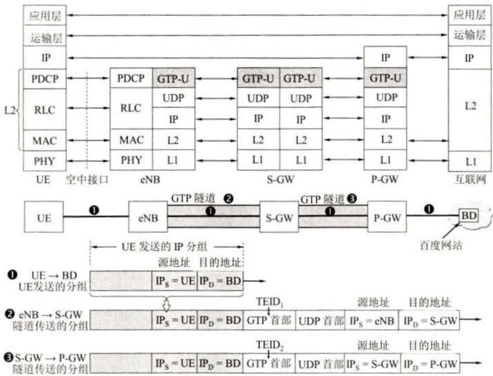
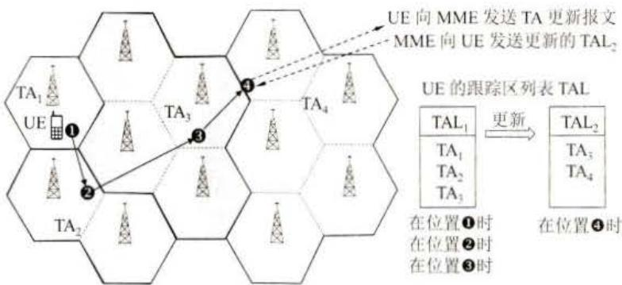

# 9.3.2 LTE网络与互联网的连接

下面讨论 LTE 网络怎样连接到互联网，这需要用到 LTE 协议栈的概念。

当用户设备 UE（如手机）开机后，就登记到 LTE 网络，以便使用网络资源来传送 IP 数据业务。在 LTE 网络内的数据路径由两大部分组成，即空口无线链路（UE→eNB）和核心网中的隧道（eNB→S-GW→P-GW）。关于“隧道”下面还要详细讲解。图 9-21 是 LTE 的协议栈（用户层面），上面说到的数据在隧道中的通信使用 GPRS 隧道协议 GTP (GPRS Tunneling Protocol)，而 GTP-U 最后的字母 U，表示所传送的是用户层面(User plane)的数据。LTE 还使用另一个控制层面的隧道协议 GTP-C 来传输有关的信令（限于篇幅，这部分内容从略）。当上下文意思很明确时，也可把 GTP-U 简写为 GTP。只要用户设备 UE 移动时不超过 P-GW 的覆盖范围，P-GW 分配给 UE 的 IP 地址就不改变。

> 图 9-21 LTE 的协议栈（用户层面）（教材第 432 页）

贵的无线频谱资源，UE 和 eNB 之间的空口链路会迅速释放，eNB 和 S-GW 之间的 GTP-U 隧道也会接着释放，从而使 UE 空口进入空闲状态。但是，S-GW 与 P-GW 之间的 GTP-U 隧道以及 UE 的 IP 地址都仍保持着。P-GW 认为该 IP 地址目前暂时归这个 UE 使用，并保留 UE 有关的信息。

当 UE 处于空口空闲状态时，有两种不同情况，即 UE 有 IP 分组发往互联网，或互联网有 IP 分组发往 UE。下面分别进行讨论（关于 UE 之间的打电话呼叫过程不在此讨论）。

(1) 假定 UE 要访问互联网中的百度网站 BD。

首先，UE 应向所在小区的基站 eNB 发送连接请求。当 eNB 收到连接请求后，就要建立空口链路和 $eNB \rightarrow S-GW$ 之间的 GTP-U 隧道。请注意，S-GW→P-GW 之间原有的 GTP-U 隧道仍存在着。然后 UE 就发送 IP 分组，从 IP 层先传送到下面的第 2 层（现在 L2 具有三个子层）。

L2 的最上层是分组数据汇聚协议 PDCP (Packet Data Convergence Protocol) 子层。PDCP 子层的主要作用是支持 IP 分组在无线链路更加有效的传输，包括对 IP 首部进行压缩/解压缩。当 UE 发送一连串的 IP 分组时，每个 IP 分组都有 20 字节的 IP 首部。这些首部中的大部分字段是重复的。若采用适当的压缩算法对首部进行压缩，就可在传输时节省大量的无线信道资源。基站 eNB 的 PDCP 子层收到已压缩首部的 IP 分组后，就进行解压缩。

下一个子层是无线链路控制 RLC (Radio Link Control) 子层。RLC 子层可提供三种不同可靠性等级的运行方式。例如，对于确认方式 AM (Acknowledged Mode)，在发送数据时，对 PDCP 子层传下来的 PDCP 协议数据单元进行分段或拼接，使其长度适合无线信道的传输。在接收数据时，则进行协议数据单元的重组，再上传到 PDCP 子层。RLC 子层还具有分组重新排序、重复数据检测以及使用差错检测协议 ARQ 进行数据重传的功能。

L2 最下面的是媒体接入控制 MAC 子层，它在 RLC 子层的逻辑信道和下面物理层的传输信道之间，完成复用和分用的功能。在无线信道质量较差的环境下，MAC 子层采用混合自动重传请求 HARQ (Hybrid ARQ) 协议，可以有效地减少重传次数 $^{①}$ 。此外，MAC 子层还按照 eNB 调度程序的安排，把无线资源动态分配给 UE，从而保证了服务质量 QoS。

在发送时，物理层对 MAC 子层传送来的数据进行编码和调制，把比特插入到每一帧中适当的时隙中，发送出去。在接收时，物理层要进行解调和解码，把收到的比特上传给 MAC 子层。物理层还采用一种自适应调制编码 AMC (Adaptive Modulation and Coding) 技术。基站 eNB 根据用户终端反馈的信道状况，动态地调整物理层采用的调制方式（QPSK 或 16QAM 或 64QAM）和编码速率。当无线信道质量较差时，物理信道的传输速率可能会远小于其峰值速率，以保证无线链路的传输质量。

在图 9-21 中，UE 发送的 IP 分组①的目的地址是 BD 的 IP 地址，记为 $IP_{D} = BD$ ；IP 分组①的源地址是 UE 的 IP 地址，记为 $IP_{S} = UE$ （后面也都用这样的简单记法）。

当基站 eNB 的 PDCP 把收到的数据解封后，要用协议 GTP-U 进行封装，并把一个 GTP 隧道端点标识符 TEID (Tunnel Endpoint Identifier) 写入到 GTP 首部中，如图中所示的 TEID $_{1}$ 。

> ① 注：HARQ 在传统的 ARQ 协议的基础上，增加称为软合并(soft combining)的纠错技术。HARQ 把收到的差错帧不是丢弃而是缓存起来，并请求发方进行重传。如仍有差错，则继续缓存和重传。HARQ 把每次缓存的帧合并起来进行解码，提高了成功解码的概率，因而减少了重传次数。

这时，UE 发送的 IP 分组已经被封装在一个新的 IP 分组②里面，在隧道中传输（eNB→S-GW）。IP 分组②的目的地址 $IP_{D}=S-GW$ ，源地址 $IP_{S}=eNB$ 。

S-GW 收到 IP 分组后，用同样的方法解封，并再次封装成在 GTP-U 隧道中传送的另一个新的 IP 分组③（S-GW→P-GW），把另一个 GTP 隧道端点标识符 TEID₂ 写入 GTP 首部。IP 分组③的目的地址 IP\_D = P-GW，源地址 IP\_S = S-GW。

我们知道，eNB 和 S-GW 之间以及在 S-GW 和 P-GW 之间，都会有很多 IP 数据报封装在各自的 GTP 隧道中传输。因此，为了标识不同的隧道，对应每一个 UE 发往某个目的地址的隧道，必须分配一个 GTP 隧道端点标识符 TEID。这也就是说，给每一个 UE 分配一个不同的隧道。接着，这个 UE 发往同一目的地址的所有 IP 数据报，都封装在这个隧道中传输。对不同的 UE 发送的 IP 数据报，会分配到不同的 GTP 隧道端点标识符 TEID，因而在各自不同的隧道中传送。

最后，P-GW 把从 GTP-U 隧道收到的 IP 分组解封，得到 UE 发送的 IP 分组，就转发到互联网的百度网站。

为什么 LTE 要使用协议 GTP 把 UE 的 IP 分组再封装到 GTP 隧道中传输呢？这是因为 LTE 蜂窝移动通信系统中，用户设备 UE 所关联的基站 eNB，在 UE 漫游时会经常改变。这就是说，同一个 UE 在不同时间可能使用不同的 eNB 或不同的 S-GW。这就使得核心网分组交换域中的 P-GW/GGSN 和 S-GW/SGSN，无法根据 UE 的 IP 地址，用传统的路由选择协议，把 IP 分组转发到 UE。但我们知道，在 LTE 网络中，所有的 eNB、S-GW 和 P-GW 的地理位置都是固定不变的，因而可以让核心网 EPC 只负责核心网内部的路由选择。由于采用了 GTP 隧道方式，UE 发送到互联网的 IP 分组，核心网将其封装为新的 IP 分组，在隧道中传送到 P-GW。以后再由 P-GW 转发给互联网中的其他路由器。同理，从互联网发送给 UE 的 IP 分组，一律先转发到 P-GW，由 P-GW 负责确定从哪个隧道转发到 S-GW 和 eNB，最后再从 eNB 转发到目的 UE。实际上，GTP 隧道早在 2G 的 GSM 引入 GPRS 时就已经使用了。我们为了节省篇幅，就只在讨论 LTE 时才进行介绍。

不难看出，从一个 UE 发送到百度服务器的往返 IP 分组，共通过 4 段隧道，两个上行隧道，两个下行隧道。一共要在 GTP 首部中使用 4 个不同的 GTP 隧道端点标识符 TEID。

(2) 百度服务器向用户设备 UE 发送数据。

百度服务器并不知道 UE 的空口状态，而只知道 UE 的 IP 地址。百度服务器以 UE 的 IP 地址为目的地址，构成 IP 分组发送出去。互联网中的路由器根据 IP 分组的目的地址，能够找到 UE 所驻留的 P-GW（因为 UE 的 IP 地址是 P-GW 分配的，因此互联网中的路由器可以根据 UE 的 IP 地址找到 P-GW）。

P-GW 通过 UE 的 IP 地址就能通过对应的 GTP-U 隧道，把 IP 分组封装为 GTP-U 分组，在隧道中转发给 S-GW。再往后就有两种情况：

\- S-GW 和 eNB 之间的 GTP-U 隧道存在。

这时，S-GW 把 GTP-U 分组通过隧道发送给 eNB。eNB 把 GTP-U 分组解封，在空口链路上采用 PDCP/RLC/MAC/PHY 层封装，把数据发送给 UE。

\- SGW 和 eNB 之间的 GTP-U 隧道不存在。

现在 UE 处于空口空闲状态。这种情况要复杂些，因为 LTE 中的所有基站 eNB 都不知道 UE 在什么地方。因此，S-GW 只好先把收到的 IP 分组暂时缓存，并触发移动性管理实体 MME 进行寻呼 UE（有时称为唤醒 UE）。那么，MME 怎样才能寻呼到 UE 呢？

MME 可以在整个的 LTE 网络中广播寻呼 UE，但这样付出的代价太大。网络运营商在建造 LTE 网络时，就把整个覆盖范围划分为很多的跟踪区 TA (Tracking Area)，网络运营商赋予每个 TA 一个跟踪区标识 TAI (Tracking Area Identity)，作为 TA 在全球的唯一标识（这里包括国家代码、网络运营商代码以及 TA 代码）。跟踪区 TA 是 LTE 系统中位置更新和寻呼的基本单位。一个跟踪区 TA 可以覆盖多个小区。当处于待机状态的 UE 必须收听邻近 eNB 的广播，以便知道自己位于哪个 TA 中。UE 必须周期性向核心网的 MME 报告自己的跟踪区标识 TAI，以便 MME 能够寻呼到自己。为了避免 UE 在 TA 区域间频繁切换时造成核心网信令负荷过重，MME 就把一组（1～16 个）TA 写入一个跟踪区列表 TAL (Tracking Area List)，发送给 UE。当 UE 在这个 TAL 范围内跨 TA 漫游时，就不必向 MME 发送 TA 更新报文。如果这时 MME 需要寻呼 UE，只需在一个 TAL 的小范围内进行寻呼。图 9-22 说明了 UE 的跟踪区列表 TAL 更新的过程。我们看到，不同的 TA 可以包含不同数量的小区。例如，TA $_{1}$ 只包含一个小区，但 TA $_{4}$ 则包含 5 个小区。假定最初 UE 在位置①，属于跟踪区 TA $_{1}$ 。UE 把这个位置信息报告给 MME，然后 MME 向 UE 发送一个跟踪区列表 TAL $_{1}$ 。图 9-22 指出 TAL $_{1}$ 包含 TA $_{1}$ ，TA $_{2}$ 和 TA $_{3}$ 共三个跟踪区。当 UE 漫游到位置②和③时，其位置仍在跟踪区列表 TAL $_{1}$ 中，因此 UE 不向 MME 发送 TA 更新报文。但当 UE 漫游到位置④时，发现新到达的 TA $_{4}$ 不在自己的跟踪区列表 TAL $_{1}$ 中，因此就向 MME 发送 TA 更新报文。MME 接着就把更新的 TAL $_{2}$ 发送给 UE。这时只要 UE 在 TAL $_{2}$ 内漫游（即在 TA $_{3}$ 和 TA $_{4}$ 的范围中），就可以不向 MME 发送 TA 更新报文，这样就减小了对核心网的信令压力。请注意，一个跟踪区 TA 可以属于多个跟踪区列表 TAL，例如，TA $_{3}$ 既在 TAL $_{1}$ 中，也在 TAL $_{2}$ 中。

> 图 9-22 UE 的跟踪区列表的更新（教材第 435 页）

因此，MME 对 UE 进行寻呼时，不必在整个 LTE 网络范围内广播，而只需向 UE 所在的跟踪区列表 TAL 内数量不太多的基站 eNB 发送寻呼报文。当某个基站 eNB 寻呼到 UE 后，UE 就在小区响应寻呼，触发 eNB 建立与 S-GW 之间的 GTP-U 隧道。之后，S-GW 把刚才缓存的 IP 分组转发给 eNB，再转发给 UE。

由于分组交换流量的突发性，同时为了节省无线空口资源，UE 经常会处于空闲状态，因此可能会发生频繁的寻呼。

当用户设备 UE 在空口链路已建立的情况下进行漫游时，UE 就要在漫游中不断测量小区导频信号强度，并将测量结果上报给基站 eNB。若 eNB 发现有更合适的小区，会触发 UE 进行切换，并在新小区建立空口链路和释放旧小区的空口链路，同时也把 eNB 和 S-GW 之间的 GTP-U 隧道从旧小区切换到新小区。由于 S-GW 覆盖范围很大，通常 S-GW 和 P-GW 之间的 GTP-U 隧道并不会重新建立。在切换过程中，数据通信不会中断。

最后还需要指出，前面所讨论的，仅仅是用户层面中数据传送的过程。在控制层面各节点之间还有非常重要的信令的传送，但这需要使用不同的协议栈。在 eNB 和 MME 之间，在 MME 和 HSS 之间，以及在两个 eNB 之间的信令传送，还要用到运输层的第三个协议，即流控制传输协议 SCTP (Stream Control Transmission Protocol)。协议 SCTP 结合了 UDP 和 TCP 的优点，是面向报文的可靠传输协议[FORO10] [RFC 4960，建议标准]。但我们没有篇幅在此进行介绍了。

关于 LTE 的简单介绍就到此为止。

在 4G 无线网络技术中，还有一个 IEEE 802.16 标准，也就是后来的 WiMAX 标准。WiMAX 是 Worldwide Interoperability for Microwave Access 的缩写（意思是“全球微波接入的互操作性”，缩写中的 AX 表示 Access）。但在流行了若干年后，现在市场上已经很难见到这种 4G 网络了。因此本书的这一版就取消有关 WiMAX 的介绍。

2011 年 3GPP 的 R10（版本 10）制定的 LTE-Advanced，简称为 LTE-A，达到了 ITU-R 制定的 4G 标准。据 2016 年 6 月的统计，全球投入商用的 LTE-A 网络已超过 100 个，分布在 49 个国家和地区。2015 年 3GPP 的 R13 制定了 LTE-A Pro，吞吐量超过了 3 Gbit/s，俗称 4.5G，表示已经超过 4G 的水平了。

从 2017 年第 4 季度开始，3GPP 又陆续发布 R15/16 等第 5 代蜂窝移动通信系统 5G 标准的版本（以后还会发布后续的 R17）。这些都是今后的热门技术，对此有兴趣的读者可多加关注。
