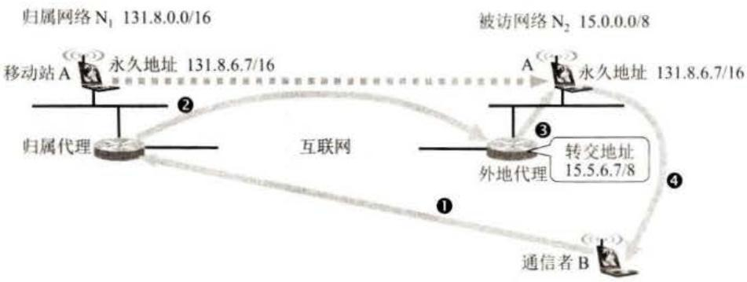
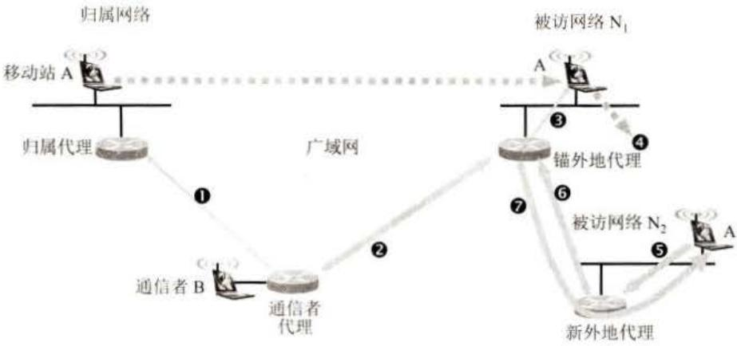

# 9.4.1 移动IP的基本概念

## 9.4 移动 IP

我们知道，手机的一个基本功能是能够边移动边进行通信。但计算机则不同。在计算机网络创建时，就默认了所有的计算机的位置都是固定不变的。没有人想让笨重的计算机边移动（如放置在汽车上）边进行通信。

后来，便携式的笔记本电脑出现了。现在就出现一种常见的情况。某用户在家中使用笔记本电脑上网，然后他关机并把笔记本电脑带到办公室重新上网。这个电脑在地理上更换了位置。但用户在办公室能够很方便地（例如接入到办公室的 Wi-Fi）通过动态主机配置协议 DHCP，自动获取新的 IP 地址。虽然电脑“移动”了，更换了地点以及所接入的网络，但这并不是移动 IP。我们可以看出，这个用户的上网方式，和传统的在固定地点上网相比，并无本质上的差异。用户在不同地点上网使用了不同的 IP 地址，但这对用户来说并不重要，因为在很多情况下，用户并不关心他所使用的具体的 IP 地址是什么。

但是，如果我们需要在移动中浏览网页，那么移动站所建立的 TCP 连接，在移动站漫游时，应当一直保持连接，否则移动站与网站的连接就会变为断断续续的（因为建立 TCP 连接需要时间，不可能瞬间就建立好）。可见，若要使移动站在移动中的 TCP 连接不中断，就必须使移动站的 IP 地址在移动中保持不变。移动 IP (Mobile IP) 就是要研究这个问题。

上一节我们已经讨论了手机怎样在移动时能够保持其 IP 地址不变的工作原理。在计算机界，怎样使计算机在移动中仍然可以使用它在移动前所使用的 IP 地址，是由 C. Perkins 在 1996 年提出的[RFC 2002]。Perkins 在随后的十几年把移动 IP 的思路更新了很多，目前最新的文档是[RFC 5944, 6275]，都只是建议标准。下面简单介绍一下移动 IP 的要点。

移动 IP 使用了一种方法，和我们几十年前怎样联系同学的做法相似。例如，一个班级的大学生在毕业时都将同时走向各自的工作岗位。由于事先并不知道自己未来的工作单位的准确通信地址，那么怎样才能继续和这些同学保持联系呢？实际上，当时使用的办法也很简单，就是彼此都留下各自的家庭地址（即永久地址）。若要和某同学联系，只要写信到该同学的永久地址，请其家长把信件转交一下即可。在得知该同学新的地址后，就可使用这个新地址直接联系了。

移动 IP 使用了如图 9-23 给出的基本概念[KURO17]。首先，移动站 A 必须有一个原始地址（相当于上面提到的家庭地址），即永久地址，或归属地址(home address)。移动站原始连接到的网络 $N_{1}$ 叫作归属网络(home network)。永久地址和归属网络的关联是不变的。在图 9-23 中，我们可以看到移动站 A 的永久地址是 131.8.6.7/16，而其归属网络是 131.8.0.0/16。

> 图 9-23 永久地址与转交地址的作用（教材第 437 页）

为了让地址的改变对互联网的其余部分是透明的，移动 IP 使用了代理。归属代理(home agent)通常就是连接在归属网络上的路由器，然而它作为代理的特定功能则是在应用层完成的。归属代理既是路由器，也是主机。

当移动站 A 移动到另一个地点，所接入的网络 $N_{2}$ 称为被访网络 (visited network) 或外地网络 (foreign network)。被访网络中使用的代理叫作外地代理 (foreign agent)，它通常就是连接在被访网络上的路由器（当然也充当主机）。假定移动站 A 到达的网络是被访网络 15.0.0.0/8。外地代理的一个任务就是要为移动站 A 创建一个临时地址，叫作转交地址 (care-of address)。转交地址的网络号显然必须和被访网络一致。我们假定现在 A 的转交地址是 15.5.6.7/8。外地代理的另一个功能就是及时把移动站 A 的转交地址通知 A 的归属代理。

请注意两点：第一，转交地址是供移动站、归属代理以及外地代理使用的，各种应用程序都不使用这种转交地址；第二，转交地址在互联网中并不具有唯一性。这就是说，外地代理可以给好几个移动站指派同样的转交地址，甚至把自己的IP地址指派为移动站的转交地址。这样做并不会引起混乱。这是因为当外地代理要向连接在被访网络上的移动站发送数据报时，并不会像通常那样使用地址解析协议ARP，而是直接使用这个移动站的MAC地址（当移动站首次和外地代理通信时，外地代理就记录下这个移动站的MAC地址）。

有时，移动站本身也可以充当外地代理，即移动站和外地代理是同一个设备。这时的转交地址叫作同址转交地址(co-located care-of address)。但是，要这样做，移动站必须能够接收发送到转交地址的数据报。使用同址转交地址的好处是移动站可以移动到任何网络，而不必担心外地代理的可用性。但缺点是移动站需要有额外的软件，使之能够充当自己的外地代理。

下面看一个例子。假定在图 9-23 中，通信者 B 要和移动站 A 进行通信。B 并不知道 A 在什么地方。但 B 可以使用 A 的永久地址作为发送的 IP 数据报中的目的地址。图中画出了四个重要步骤：

B 发送给 A 的数据报的目的地址是：131.8.6.7。此数据报被 A 的归属代理截获了（只有当 A 离开归属网络时，归属代理才能截获发给 A 的数据报）。

② 由于归属代理已经知道了 A 的转交地址（后面要讲到），因此归属代理把 B 发来的数据报进行再封装，新的数据报的目的地址是：15.5.6.7，就是 A 现在的转交地址。新封装的数据报发送到被访网络的外地代理。这里使用的就是以前 4.5.3 节或 4.8.1 节讲过的隧道技术或 IP-in-IP。

③ 被访网络中的外地代理把收到的封装的数据报进行拆封，取出 B 发送的原始数据报，然后转发给移动站 A。这个数据报的目的地址是：131.8.6.7，就是 A 的永久地址。A 收到 B 发送的原始数据报后，也得到了 B 的 IP 地址。

如果现在 A 要向 B 发送数据报，那么情况就比较简单。A 仍然使用自己的永久地址作为数据报的源地址，用 B 的 IP 地址作为数据报的目的地址。这个数据报显然没有必要在通过 A 的归属代理进行转发了。

从以上所述可以看出，为了支持移动性，在网络层应当增加以下的一些新功能。

(1) 移动站到外地代理的协议。当移动站接入到被访网络时，必须向外地代理进行登记，以获得一个临时的转交地址。同样地，当移动站离开该被访网络时，它要向这个被访网络注销其原来的登记。

(2) 外地代理到归属代理的登记协议。外地代理要向移动站的归属代理登记移动站的转交地址。当移动站离开被访网络时，外地代理并不需要注销其在归属代理登记的转交地址。这是因为当移动站接入到另一个网络时，这个新的被访网络的外地代理就会到移动站的归属代理登记该移动站现在的转交地址，这样就取代了原来旧的转交地址。

(3) 归属代理数据报封装协议。归属代理收到发送给移动站的数据报后，将其再封装为一个新的数据报，其目的地址为移动站的转交地址，然后转发。

(4) 外地代理拆封协议。外地代理收到归属代理封装好的数据报后，取出原始数据报，并将此数据报发送给移动站。

像图 9-23 所示的数据报转发过程，又称为间接路由选择。这是因为源站并不知道移动站的当前地址，而是把数据报发往移动站的归属网络，以后的寻址工作都由归属代理来完成。现在讨论移动站继续向其他网络移动时所发生的情况。

图 9-23 中移动站 A 原先所接入的网络是 $N_{1}$ ，而现在 A 要从 $N_{1}$ 移动到另一个被访网络 $N_{2}$ 去。当 A 移动到 $N_{2}$ 时，就向 $N_{2}$ 的外地代理登记， $N_{2}$ 的外地代理把 A 在 $N_{2}$ 中的转交地址告诉 A 的归属代理。此后，归属代理就会把收到的发送给 A 的数据报再封装后转发到 $N_{2}$ 的外地代理。我们注意到，在 A 的这次移动前后，数据报都是由相同的归属代理转发的。原先转发到 $N_{1}$ ，后来转发到 $N_{2}$ 。

如图 9-23 所示的这种间接路由选择，可能会引起数据报转发的低效，文献中称之为三角形路由选择问题(triangle routing problem)。意思是，本来在 B 和 A 之间可能有一条更有效的路由，但现在要走另外两条路：先要把数据报从 B 发送到 A 的归属代理，然后再转发给漫游到被访网络的 A。设想一个极端的例子。如果 B 所在的网络就是 A 到达的被访网络。在这种情况下，B 发送数据报给 A 就是在同一个网络上非常简便的直接交付，根本不需要使用路由器。但由于 B 并不知道 A 的位置，因此只好让发送给 A 的数据报两次穿越广域网，既浪费了时间，也增加了网上不必要的通信量。

解决这个问题的一种方法是使用直接路由选择，但这是以增加复杂性为代价的。这种方法就是让通信者 B 创建一个通信者代理(correspondent agent)，让这个通信者代理向归属代理询问到移动站在被访网络的转交地址，然后由通信者代理（而不是由归属代理）把数据报用隧道技术发送到被访网络的外地代理，最后再由这个外地代理拆封，把数据报转发给移动站。

使用这种方法时必须解决以下两个问题：

(1) 增加一个协议，即移动用户定位协议(mobile-user location protocol)，用来使通信者代理向移动站的归属代理查询移动站的转交地址。

(2) 当移动站再移动到其他网络时, 怎样得到移动站的位置信息? 关于这个问题, 我们可以用图 9-24 所示的几个重要步骤来说明。

> 图 9-24 使用直接路由选择向移动站发送数据报（教材第 439 页）

B 的通信者代理从移动站 A 的归属代理得到 A 所漫游到的被访网络 $N_{1}$ 的外地代理。我们把移动站首次漫游到的被访网络的外地代理称为锚外地代理(anchor foreign agent)。

② 通信者代理把 B 发给 A 的数据报再封装后，发送到 A 的锚外地代理。

③ 锚外地代理把拆封后的数据报发送给 A。

④ A 移动到另一个被访网络 $N_{2}$

⑤ A 向被访网络 $N_{2}$ 的新外地代理登记。

⑥ 新外地代理把 A 的新转交地址告诉锚外地代理。

⑦ 当锚外地代理收到发给 A 的封装数据报后，就用 A 的新转交地址对数据报进行再封装，然后发送给被访网络 $N_{2}$ 上的新外地代理。在拆封后转发给移动站 A。

同理，如果移动站再漫游到另一个网络，则这个网络的外地代理将仍然要和锚外地代理联系，以便让锚外地代理以后把发给 A 的数据报转发过来。

上面所讨论的许多问题，都是由移动站在移动时仍然要保持原来的 IP 地址（永久地址）引起的。我们在文献中常会见到移动性管理(mobility management)这样的术语，这是指上述的这些新增加的措施和协议。但有时大家更愿使用移动管理这样更加简洁的译名。移动性管理涉及的面比以上所讨论的问题还要宽些，例如，安全问题也是必须要解决的。绝对不能容许不法分子把别人发送给 A 的数据报，转发到被暗中设定的某个伪造的外地代理。

移动 IP 的实现会遇到很多具体问题。我们知道，上述的移动 IP 的基本假定就是移动站首先必须有一个永久 IP 地址。但哪个运营商会给你的移动设备指派一个永久 IP 地址呢？至少在目前这个问题在实践中尚未得到解决。限于篇幅，这里不再继续进行讨论了。
