# 附录A 部分习题的解答

## 第1章

1-10 分组交换时延较电路交换时延小的条件为： $(k - 1)p / b < s$ ，当 $x >> p$ 时

1-11 写出总时延 D 的表达式，求 D 对 p 的导数，令其为零。解出

$$ p = \sqrt {x h / (k - 1)} $$

1-15 $D/D_{0}=10$ 现在的网络时延是最小值的10倍。

1-17 (1) 发送时延为 $100 \mathrm{~s}$ , 传播时延为 $5 \mathrm{~ms}$ 。(2) 发送时延为 $1 \mu \mathrm{s}$ , 传播时延为 $5 \mathrm{~ms}$ 。若数据长度大而发送速率低, 则在总的时延中, 发送时延往往大于传播时延。但若数据长度短而发送速率高, 则传播时延就可能是总时延中的主要成分。

1-18

| 媒体长度 | 传播时延 | 媒体中的比特数 |  |
| --- | --- | --- | --- |
|  |  | 数据率=1 Mbit/s | 数据率=10 Gbit/s |
| (1) 0.1 m | ${4.35} \times {10}^{-{10}}\mathrm{\;s}$ | ${4.35} \times {10}^{-4}$ | 4.35 |
| (2) 100 m | ${4.35} \times {10}^{-7}\mathrm{\;s}$ | 0.435 | ${4.35} \times {10}^{3}$ |
| (3) 100 km | ${4.35} \times {10}^{-4}\mathrm{\;s}$ | ${4.35} \times {10}^{2}$ | ${4.35} \times {10}^{6}$ |
| (4) 5000 km | 0.0217 s | ${2.17} \times {10}^{4}$ | ${2.17} \times {10}^{8}$ |

1-19 数据长度为 100 字节时，数据传输效率为 63.3%。数据长度为 1000 字节时，传输效率为 94.5%。

1-28 (1) 1.458 s (2) 124.258 s (3) 6.28 s (4) 1 s

1-29 3.2 Mbit/s。如果改为发送 512 字节的分组，则发送速率应为 16.38 Mbit/s。

1-30 所要画出的图如图 A-1 所示。

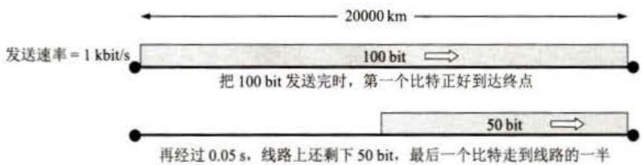

> 图A-1 习题1-30的图（教材第 445 页）

1-31 所要画出的图如图 A-2 所示。

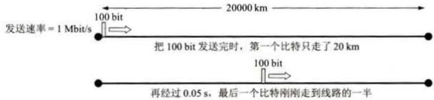

> 图A-2 习题1-31的图（教材第 445 页）

1-32 在以时间为横坐标的图上，每一个比特的宽度是 1 ns。在以距离为横坐标的图上，每一个比特的宽度是 20 cm。

1-34 (1) 5 s; 15 s。(2) 0.015s; 0.015 s; 5.01 s。

1-35 (1) $2 \times 10^{4}$ bit. (2) $250\mathrm{m}$ . (3) $50\mathrm{bit / s}$ .

1-36 吞吐量为 500 kbit/s。传送时间约为 42 s。

## 第2章

2-06 一个码元不一定对应于一个比特。

2-07 80000 bit/s。

2-08 S/N = 64.2 dB 是个信噪比很高的信道。

2-09 信噪比应增大到约100倍。如果在此基础上将信噪比 $S / N$ 再增大到10倍，最大信息速率只能再增加 $18.5\%$ 左右。

2-11 使用这种双绞线的链路的工作距离 = 28.6 km。若工作距离增大到 100 km，则衰减应降低到 0.2 dB/km。

2-12 1200 nm 到 1400 nm: 带宽 = 23.8 THz

1400 nm 到 1600 nm: 带宽 = 17.86 THz

2-16 A 和 D 发送 1，B 发送 0，而 C 未发送数据。

2-18 靠先进的编码，使得每秒传送一个码元就相当于每秒传送多个比特。

## 第3章

3-06 PPP 适用于线路质量不太差的情况下。PPP 没有编号和确认机制。

3-07 添加的检验序列是 1110。出现的两种差错都可以发现。仅仅采用了 CRC 检验，数据链路层的传输还不是可靠的传输。

3-08 余数是011。

3-09 7E FE 27 7D 7D 65 7E

3-10 第一个比特串：经过零比特填充后变成 011011111011111000（加上下划线的 0 是填充的）。另一个比特串：删除发送端加入的零比特后变成 000111011111-11111-110（连字符表示删除了 0）。

3-11 (1) 由于电话系统的带宽有限，而且还有失真，因此电话机两端的输入声波和输出声波是有差异的。在“传送声波”这个意义上讲，普通的电话通信并不是透明传输。但对“听懂说话的意思”来讲，则基本上是透明传输。但有时个别语音会听错，如单个的数字1和7。这就不是透明传输。

(2) 一般说来，电子邮件是透明传输的。但有时不是。因为国外有些邮件服务器为了防止垃圾邮件，对来自某些域名的邮件一律阻拦掉。这就不是透明传输。有些邮件的附件在收件人的电脑上打不开。这也不是透明传输。

3-14 当时很可靠的星形拓扑结构较贵。人们都认为无源的总线结构更加可靠。但实践证明，连接有大量站点的总线式以太网很容易出现故障，而现在专用的 ASIC 芯片的使用可以将星形结构的集线器做得非常可靠。因此现在的以太网一般都使用星形结构的拓扑。

3-16 每秒 20 兆码元。

3-19 从网络上负载轻重、灵活性以及网络效率等方面进行比较。网络上的负荷较轻时，CSMA/CD 协议很灵活。但网络负荷很重时，TDM 的效率就很高。

3-20 最短帧长为 10000 bit，或 1250 字节。

3-21 “比特时间”换算成“微秒”必须先知道数据率是多少。如数据率是 10 Mbit/s，则 100 比特时间等于 10 μs。

3-22 对于 10 Mbit/s 的以太网，等待时间是 5.12 ms。对于 100 Mbit/s 的以太网，等待时间是 512 μs。

3-23 实际的以太网各站发送数据的时刻是随机的，而以太网的极限信道利用率的得出是假定以太网使用了特殊的调度方法（已经不再是 CSMA/CD 了），使各站点的发送不发生碰撞。

3-24 设在 $t = 0$ 时A开始发送。在 $t = 576$ 比特时间，如无碰撞，则A应当发送完毕。 $t = 225$ 比特时间，B就检测出A的信号。只要B在 $t = 224$ 比特时间之前发送数据，A在发送完毕之前就一定能检测到碰撞，因此A不能把自己的数据发送完毕。如果A在发送完毕之前并没有检测到碰撞，那么就能够肯定A所发送的帧不会和B发送的帧发生碰撞（当然也不会和其他站点发生碰撞）。

3-25 $t = 0$ 时，A和B开始发送数据。 $t = 225$ 比特时间，A和B都检测到碰撞。 $t = 273$ 比特时间，A和B结束干扰信号的传输。 $t = 594$ 比特时间，A开始发送。 $t = 785$ 比特时间，B再次检测信道。如空闲，则B将在881比特时间发送数据。A重传的数据在819比特时间到达B，B先检测到信道忙，因此B在预定的881比特时间不发送数据。

3-26 提示：将第 $i$ 次重传失败的概率记为 $P_{i}$ ，显然

$P_{i}=(0.5)^{k},\quad k=\min[i,10]$ 故第 1 次重传失败的概率 $P_{1}=0.5$ , 第 2 次重传失败的概率 $P_{2}=0.25$ , 第 3 次重传失败的概率 $P_{3}=0.125$ 。P[传送 i 次才成功] =P[第 1 次传送失败]P[第 2 次传送失败]…P[第 i-1 次传送失败]P[第 i 次传送成功] 求{P[传送 i 次才成功]}的统计平均值，得出平均重传次数为 1.637。

3-27 (1) 10个站共享 $10\mathrm{Mbit / s}$ 。(2) 10个站共享 $100\mathrm{Mbit / s}$ 。(3) 每一个站独占 $10\mathrm{Mbit / s}$ 。

3-30 最大吞吐量为 1100 Mbit/s。三个系各有一台主机分别访问两个服务器和通过路由器上网。其他主机在系内通信。

3-31 最大吞吐量为 500 Mbit/s。每个系是一个碰撞域。

3-32 最大吞吐量为 100 Mbit/s。整个系统是一个碰撞域。

3-33

| 动作 | 交换表的状态 | 向哪些接口转发帧 | 说明 |
| --- | --- | --- | --- |
| A发送帧给D | 写入(A,1) | 略 | 略 |
| D发送帧给A | 写入(D,4) | 略 | 略 |
| E发送帧给A | 写入(E,5) | 略 | 略 |
| A发送帧给E | 更新(A,1)的有效时间 | 略 | 略 |

## 第4章

4-09 好处：转发分组更快。缺点：数据部分出现差错时不能及早发现。

4-10 IP 首部中的源地址也可能变成错误的，要求错误的源地址上的主机重传数据报是没有意义的。不使用 CRC 可减少路由器进行检验的时间。

4-11 10001011 10110001

4-12 8B B1

4-14 在目的站而不是在中间的路由器进行组装是由于：(1) 路由器处理数据报更简单些；(2) 并非所有的数据报片都经过同样的路由器，因此在每一个中间的路由器进行组装可能总会缺少几个数据报片；(3) 也许分组后面还要经过一个网络，它还要给这些数据报片划分成更小的片。如果在中间的路由器进行组装就可能会组装多次。

4-15 由于分片，共分为 4 个数据报片，故第二个局域网向上传送 3840 bit。

4-16 (1) 当网络中某个 IP 地址和硬件地址的映射发生变化时，ARP 高速缓存中的相应的项目就要改变。例如，更换以太网网卡就会发生这样的事件。10～20 分钟更换一块网卡是合理的。超时时间太短会使 ARP 请求和响应分组的通信量太频繁，而超时时间太长会使更换网卡后的主机迟迟无法和网络上的其他主机通信。

(2) 在源主机的 ARP 高速缓存中已经有了该目的 IP 地址的项目；源主机发送的是广播分组；源主机和目的主机使用点对点链路。

4-17 6 次。主机用一次，每一个路由器各使用一次。

4-18 (1) 接口 0; (2) $R_{2}$ ; (3) $R_{4}$ ; (4) $R_{3}$ ; (5) $R_{4}$ 。

4-20 3个。数据字段长度分别为1480, 1480和1020字节。片偏移字段的值分别为0, 185和370。MF字段的值分别为1, 1和0。

4-22 共同前缀是 22 位，即：11010100 00111000 100001。聚合的 CIDR 地址块是：212.56.132.0/22。

4-23 前一个地址块包含了后一个。写出这两个地址块的二进制表示就可看出。

4-24 答案如图 A-3 所示。

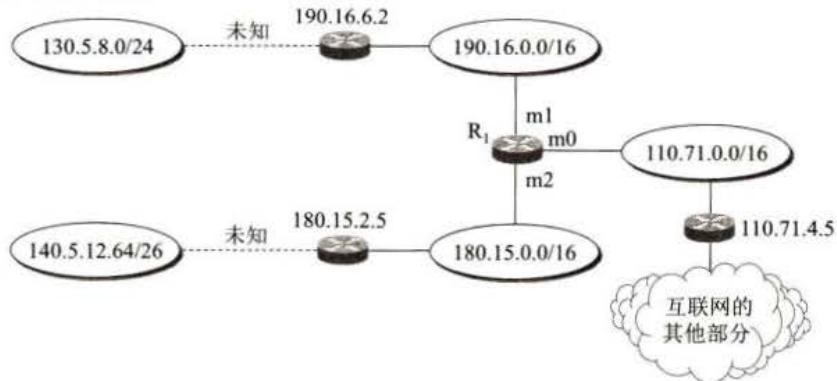

> 图A-3 习题4-28的图（教材第 448 页）

4-25 分配网络前缀时应先分配地址数较多的前缀。题目没有说 $LAN_{1}$ 上有几台主机，但至少需要三个地址给三个路由器使用。本题的解答有很多种,下面给出两种不同的答案:

|  | 第一组答案 | 第二组答案 |
| --- | --- | --- |
| $LAN_1$ | 30.138.119.192/29 | 30.138.118.192/27 |
| $LAN_2$ | 30.138.119.0/25 | 30.138.118.0/25 |
| $LAN_3$ | 30.138.118.0/24 | 30.138.119.0/24 |
| $LAN_4$ | 30.138.119.200/29 | 30.138.118.224/27 |
| $LAN_5$ | 30.138.119.128/26 | 30.138.118.128/27 |

第一组和第二组答案分别用图 A-4(a) 和 (b) 表示。这样可看得清楚些。图中注明有 LAN 的三角形表示在三角形顶点下面所有的 IP 地址都包含在此局域网的网络前缀中。

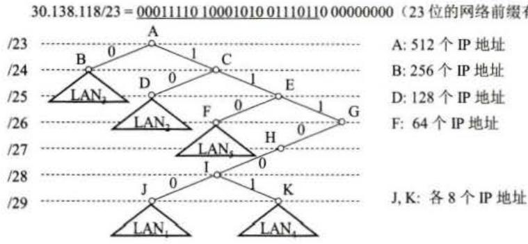

> 图 A-4(a)（教材第 449 页）

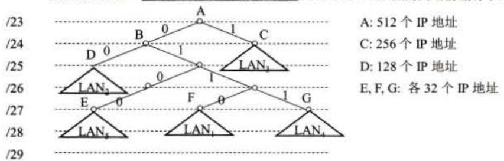

> 图 A-4(b)（教材第 449 页）

4-26 本题的解答有很多种，下面给出其中的一种答案（先选择需求较大的网络前缀）： $LAN_{1}$ ：192.77.33.0/26。 $LAN_{3}$ ：192.77.33.64/27； $LAN_{6}$ ：192.77.33.96/27； $LAN_{7}$ ：192.77.33.128/27； $LAN_{8}$ ：192.77.33.160/27。 $LAN_{2}$ ：192.77.33.192/28； $LAN_{4}$ ：192.77.33.208/28。 $LAN_{5}$ ：192.77.33.224/29（考虑到以太网上可能还要再接几台主机，故留有余地）。 $WAN_{1}$ ：192.77.33.232/30； $WAN_{2}$ ：192.77.33.236/30； $WAN_{3}$ ：192.77.33.240/30。

4-27 观察地址的第二个字节 0x32 = 00100000，前缀 12 位，说明第二字节的前 4 位在前缀中。给出的四个地址的第二字节的前 4 位分别为：0010, 0100, 0011 和 0100。因此只有(1)是匹配的。

4-28 前缀(1)和地址 2.52.90.140 匹配。

4-29 前缀(4)和这两个地址都匹配。

4-30 (1)/2; (2)/4; (3)/11; (4)/30。

4-31 最小地址是 140.120.80.0/20。

最大地址是 140.120.85.255/20。

地址数是 4096。相当于 16 个 C 类地址。

4-32 最小地址是190.87.140.200/29。最大地址是140.120.85.255/29。地址数是8。相当于1/32个C类地址。

4-33 (1) 每个子网前缀 28 位。

(2) 每个子网的地址中有 4 位留给主机用，因此共有 16 个地址。

(3) 四个子网的地址块以及每个子网分配给主机的最小地址和最大地址是：

第一个地址块 136.23.12.64/28，可分配给主机使用的

最小地址：136.23.12.65

最大地址：136.23.12.78

第二个地址块136.23.12.80/28，可分配给主机使用的最小地址：136.23.12.81最大地址：136.23.12.94

第三个地址块 136.23.12.96/28，可分配给主机使用的

最小地址：136.23.12.97

最大地址：136.23.12.110

第四个地址块 136.23.12.112/28，可分配给主机使用的最小地址：136.23.12.113 最大地址：136.23.12.126

4-36 RIP 只和邻站交换信息，UDP 虽不保证可靠交付，但 UDP 开销小，可以满足 RIP 的要求。OSPF 使用可靠的洪泛法，并直接使用 IP，好处是灵活性好和开销更小。BGP 需要交换整个的路由表（在开始时）和更新信息，TCP 提供可靠交付以减少带宽的消耗。RIP 使用不保证可靠交付的 UDP，因此必须不断地（周期性地）和邻站交换信息才能使路由信息及时得到更新。但 BGP 使用保证可靠交付的 TCP，因此不需要这样做。

4-37 路由器 B 更新后的路由表如下：

$\mathrm{N_1}$ 7 A 无新信息，不改变。 $\mathrm{N_2}$ 5 C 相同的下一跳，更新。 $\mathrm{N_3}$ 9 C 新的项目，添加进来。 $\mathrm{N_6}$ 5 C 不同的下一跳，距离更短，更新。 $\mathrm{N_8}$ 4 E 不同的下一跳，距离一样，不改变。 $\mathrm{N_9}$ 4 F 不同的下一跳，距离更大，不改变。

4-38 (1) eBGP (2) iBGP (3) eBGP (4) iBGP 4-39 (1) 从接口 1 转发。(2) 从接口 2 转发。(3) 从接口 1 转发。4-43 (1) 129.11.11.239 (2) 193.131.27.255 (3) 231.219.139.111 (4) 249.155.251.15 4-44 1024

4-45 网络掩码是 255.255.255.224。网络前缀长度是 27，网络后缀长度是 5。网络前缀是 167.199.170.64/27。

4-46 地址块的首地址：10100111 11000111 10101010 01000000 地址块的末地址：10100111 11000111 10101010 01011111 地址数：32

4-47 分配给子网 $\mathrm{N}_{1}$ （/25）的首地址是14.24.74.0，末地址是14.24.74.127。分配给子网 $\mathrm{N}_{2}$ （/26）的首地址是14.24.74.128，末地址是14.24.74.191。分配给子网 $\mathrm{N}_{3}$ （/28）首地址是14.24.74.192，末地址是14.24.74.207。

4-48 (1) 路由器 R 的路由表

| 网络前缀 | 下一跳 |
| --- | --- |
| 145.13.0.0/18 | 直接交付,接口m0 |
| 145.13.64.0/18 | 直接交付,接口m1 |
| 145.13.128.0/18 | 直接交付,接口m2 |
| 145.13.192.0/18 | 直接交付,接口m3 |
| 0.0.0.0/0 | 默认路由器,接口m4 |

(2) 收到的分组从路由器的接口 m2 转发。

4-49 根据最长前缀匹配准则，应当选择路由3。

4-50 最长前缀匹配准则是没有问题的，问题出在主机 H 的 IP 地址。请注意，网络 11.1.2.0/24 是网络 11.0.0.0/8 的一个子网，而 IP 地址 11.1.2.3 正是子网 11.1.2.0/24 中的一个合法 IP 地址。网络 11.0.0.0/8 在分配本网络的主机号时，不允许重复使用子网 11.1.2.0/24 中的任何一个地址。因此，网络 11.0.0.0/8 给它的一台主机分配 IP 地址 11.1.2.3 是不能允许的。这样做就和网络 11.1.2.0/24 中的 IP 地址 11.1.2.3 重复，因而引起了地址上的混乱。

4-51 (1) 200.56.168.0/21 = 11001000 00111000 10101000 00000000

上面有下画线的粗体数字表示网络前缀。

(2) 这个 CIDR 地址块包含 8 个 C 类地址块。

4-52 对首部的处理更简单。数据链路层已经将有差错的帧丢弃了，因此网络层可省去这一步骤。但可能遇到数据链路层检测不出来的差错（此概率极小）。

4-53 在 IP 数据报传送的路径上所有路由器都不需要这一字段的信息，只有目的主机才需要协议字段。在 IPv6 使用 “下一个首部” 字段完成 IPv4 中的 “协议” 字段的功能。

4-55 分片与重装是非常耗时的操作。IPv6 把这一功能从路由器中删除，并移到网络边缘的主机中，就可以大大加快网络中 IP 数据报的转发速度。

4-56 IPv6 的地址空间共有 $2^{128}$ 个地址，或 $3.4 \times 10^{38}$ 。1 秒分配 $10^{18}$ 个地址，可分配 $1.08 \times 10^{13}$ 年。大约是宇宙年龄的 1000 倍。地址空间的利用不会是均匀的，但即使只利用整个地址空间的 1/1000，那也是不可能用完的。

4-57 (1) ::F53:6382:AB00:67DB:BB27:7332

(2) ::4D:ABCD

(3) ::AF36:7328:0:87AA:398

(4) 2819:AF::35:CB2:B271

4-58 (1) 0000:0000:0000:0000:0000:0000:0000:0000

(2) 0000:00AA: 0000:0000:0000:0000:0000:0000

(3) 0000:1234:0000:0000:0000:0000:0000:0003

(4) 0123:0000:0000:0000:0000:0000:0001:0002

4-63 (1) 路由器 $\mathbf{R}_1$ 的转发表如下：

| 前缀匹配 | 转发接口 |
| --- | --- |
| 123.1.2.16/29 | 4 |

(2) 无法实现给出的条件。

(1)

| 前缀匹配 | 转发接口 |
| --- | --- |
| 224.0.0.0/16 | 1 |
| 224.0.0.0/15 | 0 |
| 224.0.0.0/7 | 2 |
| 224.0.0.0/5 | 3 |
| 其他 | 3 |

(2) (a) 接口 2; (b) 接口 1; (c) 接口 3。

| 匹配 | 动作 |
| --- | --- |
| 入端口 = 1; IP 源地址 = 10.3.*.*; IP 目的地址 = 10.1.*.* | 转发(2) |
| 入端口 = 2; IP 源地址 = 10.1.*.*; IP 目的地址 = 10.3.*.* | 转发(1) |
| 入端口 = *; IP 源地址 = 10.3.*.*; IP 目的地址 = 10.2.0.3 | 转发(3) |
| 入端口 = *; IP 源地址 = 10.3.*.*; IP 目的地址 = 10.2.0.4 | 转发(4) |
| 入端口 = 3; IP 源地址 = 10.2.0.3; IP 目的地址 = 10.2.0.4 | 转发(4) |
| 入端口 = 4; IP 源地址 = 10.2.0.4; IP 目的地址 = 10.2.0.3 | 转发(3) |
| ...... | ...... |

## 第5章

5-03 都是。这要在不同层次来看。在运输层是面向连接的，在网络层则是无连接的。

5-06 丢弃。

5-11 IP 数据报只能找到目的主机而无法找到目的进程。UDP 提供对应用进程的复用和分用功能，并提供对数据部分的差错检验。

5-12 不行。重传时，IP 数据报的标识字段会有另一个标识符。标识符相同的 IP 数据报片才能组装成一个 IP 数据报。前两个 IP 数据报片的标识符与后两个 IP 数据报片的标识符不同，因此不能组装成一个 IP 数据报。

5-13 6个。数据字段的长度：前5个是1480字节，最后一个是800字节。片偏移字段的值分别是：0,185,370,555,740和925。

5-14 源端口为 1586，目的端口为 69，UDP 用户数据报总长度为 28 字节，数据部分长度为 20 字节。此 UDP 用户数据报是从客户发给服务器的（因为目的端口号 < 1023，是熟知端口）。服务器程序是 TFTP（从 5.1.3 节表 5-2 的常用熟知端口号的表可查出）。

5-15 UDP 不保证可靠交付，但 UDP 比 TCP 的开销要小很多。因此只要应用程序接受这样的服务质量就可以使用 UDP。如果话音数据不是实时播放（边接收边播放）就可以使用 TCP，因为 TCP 传输可靠。接收端用 TCP 将话音数据接收完毕后，可以在以后的任何时间进行播放。但假定是实时传输，则必须使用 UDP。

5-18 如图 A-5 所示。

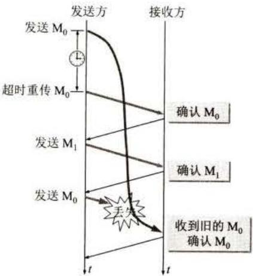

> 旧的 $\mathbf{M}_0$ 被当成是新的 $\mathbf{M}_0!$ 图A-5 习题5-18的图（教材第 453 页）

5-19 如图 A-6 所示，设发送窗口记为 $W_{T}$ ，接收窗口记为 $W_{R}$ 。假定用 3 比特进行编号。设接收窗口正好在 7 号分组处（有阴影的分组）。发送窗口 $W_{T}$ 的位置不可能比②更靠前，也不可能比③更靠后，也可能不是这种极端位置，如①。对于①和②的情况，在 $W_{T}$ 的范围内无重复序号，即 $W_{T} \leqslant 2^{n}$ 。对于③的情况，在 $W_{T} + W_{R}$ 的范围内无重复序号，即 $W_{T} + W_{R} \leqslant 2^{n}$ 。

现在 $W_{R}=1$ ，故发送窗口的最大值 $W_{T}\leqslant2^{n}-1$ 。

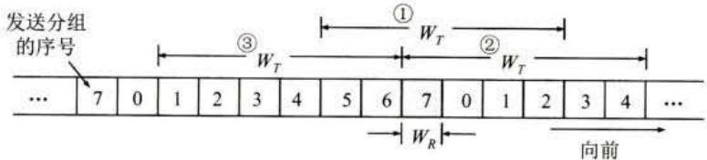

> 图A-6 习题5-19的图（教材第 453 页）

5-20 用相对发送时间实现一个链表（见图 A-7）。

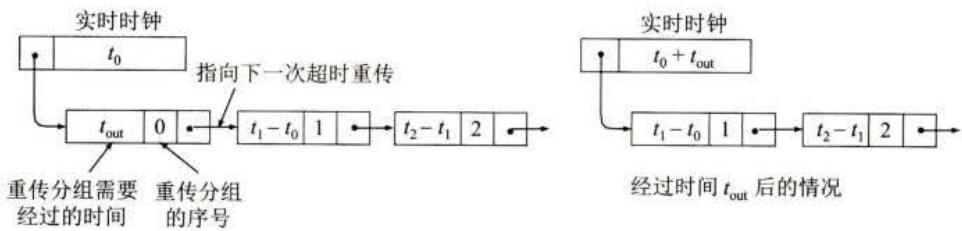

> 图A-7 习题5-20的图（教材第 453 页）

5-21 (1) 序号到 4 为止的分组都已收到。若这些确认都已到达发送方, 则发送窗口的范围是[5, 7]。假定所有的确认都丢失了, 发送方没有收到这些确认。这时, 发送窗口应为[2, 4]。因此, 发送窗口可以是[2, 4], [3, 5], [4, 6], [5, 7]中的任何一个。

(2) 接收方期望收到序号 5 的分组，说明序号为 2, 3, 4 的分组都已收到，并且发送了确认。对序号为 1 的分组的确认肯定被发送方收到了，否则发送方不可能发送 4 号分组。可见，对序号为 2, 3, 4 的分组的确认有可能仍滞留在网络中。这些确认用来确认序号为 2, 3, 4 的分组。

5-22 (1) L 的最大值是 4 GB, $G = 2^{30}$ 。

(2) 发送的总字节数是 4489123390 字节。

发送 4489123390 字节所需时间为：3591.3 秒，即 59.85 分，约 1 小时。

5-23 (1) 第一个报文段的数据序号是 70 到 99，共 30 字节的数据。

(2) 确认号应为 100。

(3) 80 字节。

(4) 70。

5-24 设发送窗口 = W(bit)。发送端连续发送完窗口内的数据所需的时间 = T。

有两种情况（见图 A-8）。

(a) 接收端在收完一批数据的最后才发出确认，因此发送端经过 $(256\mathrm{ms} + T)$ 后才能发送下一个窗口的数据。

(b) 接收端每收到一个很小的报文段后就发回确认，因此发送端经过比 256 ms 略多一些的时间即可再发送数据。因此每经过 256 ms 就能发送一个窗口的数据。

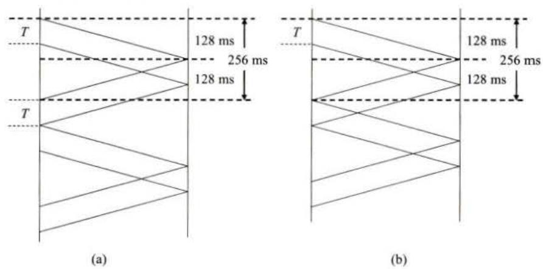

> 图A-8 习题5-24的图（教材第 454 页）

对于(a):

$W = 57825.88$ bit，约为7228字节。

对于(b):

$$ W = 3 0 7 2 0 \mathrm{bit} = 3 8 4 0 \mathrm{B} $$

5-25 在 ICMP 的差错报文中（见图 4-28）要包含 IP 首部后面的 8 个字节的内容，而这里面有 TCP 首部中的源端口和目的端口。当 TCP 收到 ICMP 差错报文时需要用这两个端口来确定是哪条连接出了差错。

5-26 TCP 首部除固定长度部分外，还有选项，因此 TCP 首部长度是可变的。UDP 首部长度是固定的。

5-27 65495 字节。此数据部分加上 TCP 首部的 20 字节，再加上 IP 首部的 20 字节，正好是 IP 数据报的最大长度。当然，若 IP 首部包含了选择，则 IP 首部长度超过 20 字节，这时 TCP 报文段的数据部分的长度将小于 65495 字节。

5-28 分别是 $\mathbf{n}$ 和 $\mathbf{m}$ 。

5-29 还未重传就收到了对更高序号的确认。

5-30 在发送时延可忽略的情况下，最大数据率 = 26.2 Mbit/s。

5-31 最大吞吐量为 25.5 Mbit/s。信道利用率为 25.5/1000 = 2.55%。

5-33 (1) RTO = 4.5s。

(2) RTO = 4.75s。

5-34 三次算出加权平均往返时间分别为 29.6 ms, 29.84 ms 和 29.256 ms。

可以看出，RTT 的样本值变化多达 20% 时，加权平均往返时间 RTTs 的变化却很小。

5-35 (1) 10 RTT; (2) 14 RTT; (3) 有效吞吐率 = 119.8 Mbit/s。链路带宽利用率 = 11.98%。

5-36 拥塞窗口与 RTT 的关系如下（只给出了部分数据）：

| RTT | 0 | 4 | 9 | 11 | 14 | 18 |
| --- | --- | --- | --- | --- | --- | --- |
| 拥塞窗口(pkt) | 1 | 2 | 3 | 2 | 2 | 2 |

5-38 拥塞窗口大小分别为：1, 2, 4, 8, 9, 10, 11, 12, 1, 2, 4, 6, 7, 8, 9。

5-39 (1) 拥塞窗口与 RTT 的关系曲线如图 A-9 所示。

(2) 慢开始时间间隔： $[RTT = 1, RTT = 6]$ 和 $[RTT = 23, RTT = 26]$ 。

(3) 拥塞避免时间间隔： $[RTT = 6, RTT = 16]$ 和 $[RTT = 17, RTT = 22]$ 。

(4) 在 RTT = 16 之后发送方通过收到三个重复的确认检测到丢失了报文段。在 RTT = 22 之后发送方是通过超时检测到丢失了报文段。

(5) 在 RTT = 1 发送时，门限 ssthresh 被设置为 32。

在 RTT = 18 发送时，门限 ssthresh 被设置为发生拥塞时的一半，即 21。

在 RTT = 24 发送时，门限 ssthresh 是 13。

(6) 第 70 报文段在 RTT = 7 发送出。

(7) 拥塞窗口 cwnd 和门限 ssthresh 应设置为 8 的一半，即 4。

5-40 例如，当 IP 数据报在传输过程中需要分片，但其中的一个数据报片未能及时到达终点，而终点组装 IP 数据报已超时，因而只能丢弃该数据报；IP 数据报已经到达终点，但终点的缓存没有足够的空间存放此数据报；数据报在转发过程中经过一个局域网的网桥，但网桥在转发该数据报的帧时没有足够的差错空间而只好丢弃。

5-42 如果 B 不再发送数据了，是可以把两个报文段合并成为一个，即只发送 FIN + ACK 报文段。但如果 B 还有数据要发送，而且要发送一段时间，那就不行，因为 A 迟迟收不到确认，就会以为刚才发送的 FIN 报文段丢失了，就超时重传这个 FIN 报文段，浪费网络资源。

5-43 当 A 和 B 都作为客户，即同时主动打开 TCP 连接。这时每一方的状态变迁都是：

$$ \text { CLOSED } \rightarrow \text { SYN - SENT } \rightarrow \text { SYN - RCVD } \rightarrow \text { ESTABLISHED } $$

5-47 发送窗口的两种不同情况分别如图 A-10(a) 和 (b) 所示。根据此图，很容易证明本题。

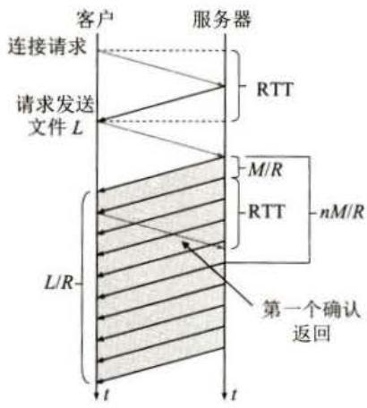

> (a) 当 $nM > R(\mathrm{RTT}) + M$（教材第 456 页）

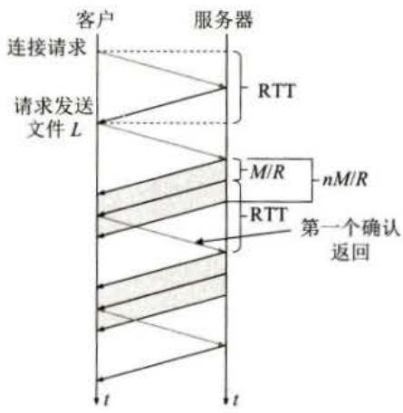

> (b) 当 $nM < R(\mathrm{RTT}) + M$ 图A-10 习题5-47的图（教材第 456 页）

5-48 8.704 kbit/s

5-49 (1) 52100 (2) 13 (3) 28 字节 (4) 20 字节 (5) 分组是从客户到服务器 (6) Daytime 5-51 (1) 置为全 0 (2) 全 0 (3) 全 1

5-52 UDP 用户数据报的检验和既检验 UDP 用户数据报的首部又检验整个的 UDP 用户数据报的数据部分，而 IP 数据报的检验和仅仅检验 IP 数据报的首部。UDP 用户数据报的检验和还增加了伪首部，即还检验了下面的 IP 数据报的源 IP 地址和目的 IP 地址。

5-53 UDP的最小长度是8字节，最短IP数据报的长度是28字节。5-54 0.667 5-55 0.364 5-56 0.222 5-58 4秒

5-59 窗口的变化如图 A-11 所示。

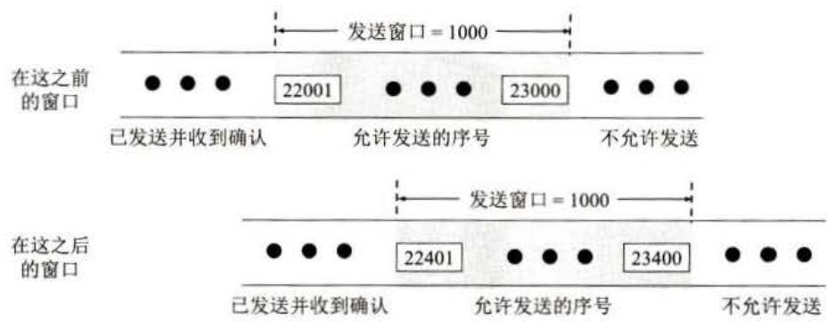

> 图A-11 习题5-59的图（教材第 457 页）

5-65 无法知道应写入什么数值。

5-66 仅在此报文段中仅有1个字节的数据时，下一个报文段的序号才是 $x+1$ 。

5-67 TCP 的吞吐量本来并没有标准的定义，TCP 的吞吐量可定义为每秒发送的数据字节数。计算机内部的数据传送是以每秒多少字节作为单位的，而在通信线路上的数据率则常用每秒多少比特作为单位。

5-69 取序号字段长度 n=33 位。但应注意，TCP 的序号字段为 32 位。

5-70 (1) 859 ms (2) 42.7 天

5-73 这种情况是允许的。

## 第6章

6-04 有可能，如果你能够直接使用对方的邮件服务器的 IP 地址。

6-09 404 Not Found。

6-10 应用层协议需要的是DNS。运输层协议需要的是UDP（DNS使用）和TCP（HTTP使用）。

6-14 (1) 错误；(2) 正确；(3) 错误；(4) 错误。

6-15 解析 IP 地址需要的时间是： $RTT_{1} + RTT_{2} + \cdots + RTT_{n}$ 。建立 TCP 连接和请求万维网文档需要 $2RTT_{W}$ 。需要的总时间是： $2RTT_{W} + RTT_{1} + RTT_{2} + \cdots + RTT_{n}$

6-16 (1) 所需时间 = $RTT_{1} + RTT_{2} + \cdots + RTT_{n} + 8RTT_{w}$ (2) 所需时间 = $RTT_{1} + RTT_{2} + \cdots + RTT_{n} + 4RTT_{w}$ (3) 所需时间 = $RTT_{1} + RTT_{2} + \cdots + RTT_{n} + 3RTT_{w}$

6-18 约 11.6 天。

6-26 4200 字节。

6-27 对应的 ASCII 数据为 zIE4，对应的二进制代码为：01111010 01001001 01000101 00110100。6-28 01001100 00111101 00111001 01000100 00111001。编码开销为 66.7%。

6-29 非常困难。例如，人名的书写方法，很多国家（如英、美等西方国家）是先写名再写姓。但像中国或日本等国家则先写姓再写名。有些国家的一些人还有中间的名。称呼也有非常多种类。还有各式各样的头衔。很难有统一的格式。

6-30 有时对方的邮件服务器不工作，邮件就发送不出去。对方的邮件服务器出故障也会使邮件丢失。

6-40 整个的编码为 30 18 02 04 00 00 09 29 02 04 00 00 04 D4 02 04 00 00 00 7A 02 04 00 00 04 D4

6-41 变量 icmpInParmProbs 的对象标识符是 1.3.6.1.2.1.5.5，加上后缀 “.0”。A0 1D 02 04 00 01 06 14 02 01 00 02 01 00 30 0F 30 0D 06 09 01 03 06 01 02 01 05 05 00 05 00

6-42 {1.3.6.1.2.1.6}

6-43 40 04 83 15 0E 02

6-48 NF/u

6-49 $[\log_{2}(N+1)]F/u$

6-50 F/u

6-51 (1) 文件分发时间的最小值都是 $7.5 \times 10^{3} \mathrm{~s}$ 。(2) 客户-服务器方式下，文件分发的最小时间是 $5 \times 10^{5} \mathrm{~s}$ 。在 P2P 方式下，文件分发的最小时间是 $45.5 \times 10^{3} \mathrm{~s}$ 。

## 第7章

7-06 the time has come the walrus said to talk of many things of ships and shoes and sealing wax of cabbages and kings of why the sea is boiling hot and whether pigs have wings but wait a bit the oysters cried before we have our chat for some of us are out of breath and all of us are fat no hurry said the carpenter they thanked him much for that From Through the looking glass (Tweedledum and Tweedledee)

## 第8章

8-04 不一样。实时数据往往是等时的数据，但等时的数据不一定是实时数据。

8-15 (2) 分组在接收端缓存中应增加的时延分别为（单位为 ms）：30, 25, 22, 29, 45, 35, 29, 26, 20 和 24。

(3) 以时间 t 为横坐标，分组数 N 为纵坐标。

$$ t < 4 5, N = 0; 4 5 \leqslant t < 6 0, N = 1; 6 0 \leqslant t < 7 0, N = 2; 7 0 \leqslant t < 7 3, N = 3; \dots $$

$t > 165, N = 0$ 。

8-16 显然， $\Delta$ 应小于话音分组长度 10 ms。如果将 $\Delta$ 取为 9 ms，则有：

时钟时间：0 9 18 27 36 45 54 63 72 81 90 99 108 … 计数器值：0 1 2 3 4 5 6 7 8 9 10 11 12 …

话音分组每隔 10 ms 产生一个，对应的时间戳值（即计数器值）为：

话音分组产生时间：0 10 20 30 40 50 60 70 80 90 100 110 … 应加上的时间戳值：0 1 2 3 4 5 6 7 8 10 11 12 …

我们看到时间戳值在 8 到 10 之间缺了一个。可见将 $\Delta$ 取为略小于话音分组长度 10 ms 是不行的。

正确的做法是使 $2\Delta$ 或 $3\Delta$ 等于话音分组长度。当话音分组丢失时，时间戳值会相差 $4\Delta$ 或 $5\Delta$ ，由此来判定是否发生了分组丢失。

8-17 接收端缓存空间的上限取决于还原播放时所容许的时延。当还原播放时所容许的时延已确定时，缓存空间的上限与实时数据流的数据率成正比。时延抖动越大，缓存空间也应更大。

8-21 (1) 可能是 121312131213…，也可能是 1123112311231123…。

(2) 113113113113 $\cdots$ 。

8-23 $T = b / (N - r)$ 。

8-24 12.5 ms。当 N=2500 pkt/s 时，T=任意长的时间，漏桶被权标装满后就不再增加权标。

8-26 在图 A-12 中，流 1 的发送速率（即离开 WFQ 队列的速率） $\geqslant w_{1}R / (\Sigma w_{i})$ 。如果所有的流的队列中都有分组，那么上面的公式的 “ $\geqslant$ ” 就应当取为 “=”。如果有的队列中没有分组，WFQ 就跳过这个队列，因此这个流得到的服务时间就会多一些。现在设：

$t_{0}=$ 队列刚刚积累了分组需要排队等待的时刻（从这时起到达的分组就要排队了），t= 流1队列处于忙状态， $t>t_{0}$ （队列忙就是队列中有排队的分组）。

$T_{1}(t_{0},t)=$ 在时间间隔 $[t_{0},t]$ 内，流1发送到网络的分组数。

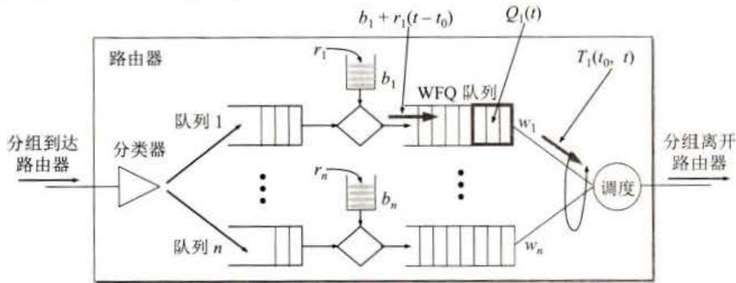

> 图 A-12 习题 8-26 的图（教材第 459 页）

显然，

$$ T _ {1} \left(t _ {0}, t\right) \geqslant w _ {1} R \left(t - t _ {0}\right) / \left(\Sigma w _ {i}\right) $$

令 $Q_{1}(t)=$ 在时间 t 时流 1 在 WFQ 队列中排队的分组数。显然

$Q_{1}(t)=$ 进入 WFQ 队列的分组数 - 离开 WFQ 队列的分组数

$$ = b _ {1} + (t - t _ {0}) [ r _ {1} - w _ {1} R / (\Sigma w _ {i}) ] $$

因为 $r_{1}<Rw_{1}/(\Sigma w_{i})$ （题目已知），所以 $Q_{1}(t)\leqslant b_{1}$ ，故流 1 在 WFQ 队列中排队的分组数的最大值是 $b_{1}$ 。

这些分组被服务的速率的最小值是 $w_{1}R / (\Sigma w_{i})$ ，因此流1中任何分组的最大时延是

$$ b _ {1} (\Sigma w _ {i}) / w _ {1} R = d _ {\max} $$

8-27 如图 A-13 所示，第二个漏桶的大小是 1，权标产生的速率是 p/s。

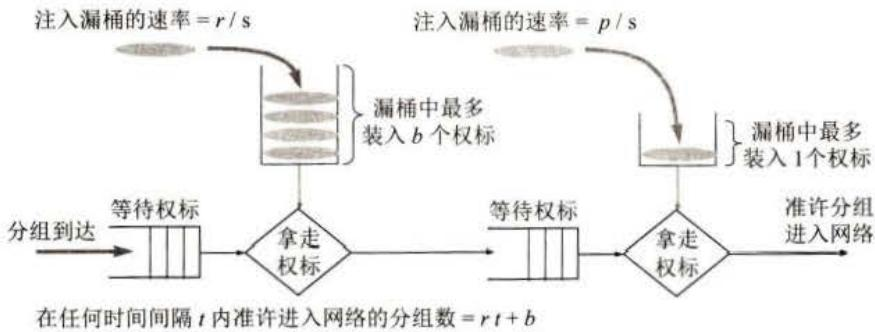

> 图A-13 习题8-27的图（教材第 460 页）

8-32 按题意，此二叉树的叶节点有 $2^{n}$ 个，故二叉树的深度为 $n + 1$ 。每一个节点向其上游节点发送一个RESV报文，故总共发送 $2^{n + 1} - 1$ 个RESV报文。

8-33 80 kbit/s。25%。

8-34 (2) 3, 4, 6, 7, 8。(3) 3 和 6。(4) t = 10。

8-35 (1) 20 kbit/s。 (2) 5 kbit/s。

## 第9章

9-24 (1) 一般来说，两个无线网络的名字不会是一样的。如果 A 和 B 只有一个人在通话，那么是可以的。虽然两个 AP 都能同时收到信号，但其中的一个会丢弃地址错误的帧。如果两人同时进行通话，由于信道 11 是共同使用的，就必然产生冲突，两个 AP 无法正常工作。

(2) 两个 AP 可以正常工作。

9-26 总共的时间 = 974.2 μs。

9-27 (1) 1 报文/2 时隙。(2) 2 报文/1 时隙。(3) 1 报文/1 时隙。

(4) ① 1 报文/1 时隙。② 2 报文/1 时隙。③ 2 报文/1 时隙。

(5) ① 1 报文/4 时隙。② 时隙 1: 报文 A→B, 报文 D→C; 时隙 2: ACK B→A; 时隙 3: ACK C→D。得出 2 报文/3 时隙。③ 时隙 1: 报文 C→D; 时隙 2: ACK D→C, 报文 A→B,; 时隙 3: ACK B→A。得出 2 报文/3 时隙。
