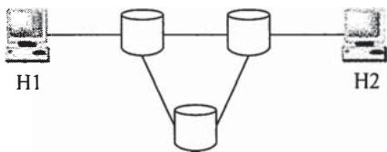

# 2010 年真题 · 单项选择题 · 第 34 题

在右图所示的采用 “存储-转发” 方式的分组交换网络中，所有链路的数据传输速率为 100Mbps，分组大小为 1000B，其中分组头大小为 20B。若主机 H1 向主机 H2 发送一个大小为 980000B 的文件，则在不考虑分组拆装时间和传播延迟的情况下，从 H1 发送开始到 H2 接收完为止，需要的时间至少是____。

A. 80ms  
B. 80.08ms  
C. 80.16ms  
D. 80.24ms
