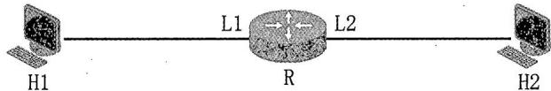

# 2023 年真题 · 单项选择题 · 第 33 题

在下图所示的分组交换网络中, 主机 H1 和 H2 通过路由器互连, 2 段链路的带宽均为 $100 \mathrm{Mbps}$ , 时延带宽积 (即单向传播时延 $\times$ 带宽) 均为 $1000 \mathrm{bits}$ 。若 H1 向 H2 发送 1 个大小为 $1 \mathrm{MB}$ 的文件, 分组长度为 $1000 \mathrm{~B}$ , 则从 H1 开始发送时刻起到 H2 收到文件全部数据时刻止, 所需的时间至少是 (注: $\mathbf{M} = 10^{6}$ ) ( )。

A. $80.02 \mathrm{~ms}$  
B. $80.08 \mathrm{~ms}$  
C. $80.09 \mathrm{~ms}$  
D. $80.10 \mathrm{~ms}$
