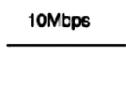
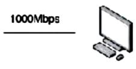

# 2025 年真题 · 单项选择题 · 第 33 题

如下图所示, 主机 H1 向 H2 发送一个 2MB (1M=10 $^{6}$ B) 文件有三种方式, ①电路交换, 建立时间为 32us, 速度为 10Mbps; ②分组交换, 文件长度为 400B, 忽略首部; ③报文交换。电路交换的时间为 $T_{cs}$ , 报文交换的时间为 $T_{ms}$ , 分组交换的时间为 $T_{ps}$ , 则三者的大小关系是

H1

R1

R2

H2

A. $\mathrm{T_{cs} > T_{ms} > T_{ps}}$  
B. $\mathrm{T_{ms} > T_{ps} > T_{cs}}$  
C. $\mathrm{T_{ms} > T_{cs} > T_{ps}}$  
D. $\mathrm{T_{ps} > T_{ms} > T_{cs}}$
