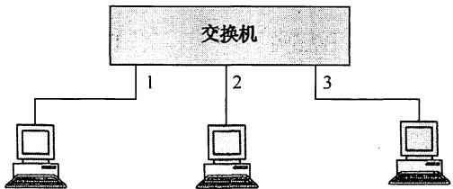
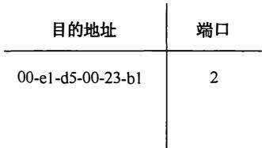

# 2014 年真题 · 单项选择题 · 第 34 题

某以太网拓扑及交换机当前转发表如下图所示，主机 00-e1-d5-00-23-a1 向主机 00-e1-d5-00-23-c1 发送 1 个数据帧，主机 00-e1-d5-00-23-c1 收到该帧后，向主机 00-e1-d5-00-23-a1 发送 1 个确认帧，交换机对这两个帧的转发端口分别是 ____。

  
00-e1-d5-00-23-a1  
00-e1-d5-00-23-b1

  
00-e1-d5-00-23-c1

A. $\{3\}$ 和 $\{1\}$  
B. $\{2,3\}$ 和 $\{1\}$  
C. $\{2,3\}$ 和 $\{1,2\}$  
D. $\{1,2,3\}$ 和 $\{1\}$
