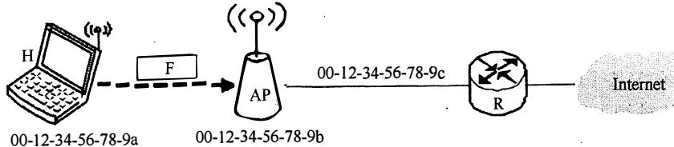

# 2017 年真题 · 单项选择题 · 第 35 题

在下图所示的网络中，若主机 H 发送一个封装访问 Internet 的 IP 分组的 IEEE 802.11 数据帧 F，则帧 F 的地址 1、地址 2 和地址 3 分别是 ____。

A. 00-12-34-56-78-9a, 00-12-34-56-78-9b, 00-12-34-56-78-9c  
B. 00-12-34-56-78-9b, 00-12-34-56-78-9a, 00-12-34-56-78-9c  
C. 00-12-34-56-78-9b, 00-12-34-56-78-9c, 00-12-34-56-78-9a  
D. 00-12-34-56-78-9a, 00-12-34-56-78-9c, 00-12-34-56-78-9b
