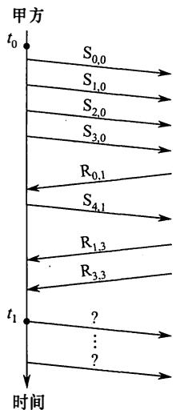
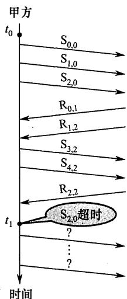

# 2017 年真题 · 综合应用题 · 第 47 题

（9分）甲乙双方均采用后退 $N$ 帧协议（GBN）进行持续的双向数据传输，且双方始终采用捎带确认，帧长均为 $1000\mathrm{B}$ 。 $\mathbf{S}_{x,y}$ 和 $\mathbb{R}_{x,y}$ 分别表示甲方和乙方发送的数据帧，其中 $x$ 是发送序号， $y$ 是确认序号（表示希望接收对方的下一帧序号）；数据帧的发送序号和确认序号字段均为3比特。信道传输速率为 $100\mathrm{Mbps}$ ， $\mathrm{RTT} = 0.96\mathrm{ms}$ 。下图给出了甲方发送数据帧和接收数据帧的两种场景，其中 $t_0$ 为初始时刻，此时甲方的发送和确认序号均为0， $t_1$ 时刻甲方有足够多的数据待发送。

(a)

(b)

请回答下列问题。

(1) 对于图 (a), $t_0$ 时刻到 $t_1$ 时刻期间, 甲方可以断定乙方已正确接收的数据帧数是多少? 正确接收的是哪几个帧? (请用 $\mathbf{S}_{x,y}$ 形式给出。)

（2）对于图（a），从 $t_{1}$ 时刻起，甲方在不出现超时且未收到乙方新的数据帧之前，最多还可以发送多少个数据帧？其中第一个帧和最后一个帧分别是哪个？（请用 $S_{x,y}$ 形式给出。）

（3）对于图（b），从 $t_1$ 时刻起，甲方在不出现新的超时且未收到乙方新的数据帧之前，需要重发多少个数据帧？重发的第一个帧是哪个？（请用 $\mathbf{S}_{xy}$ 形式给出。）

（4）甲方可以达到的最大信道利用率是多少？
