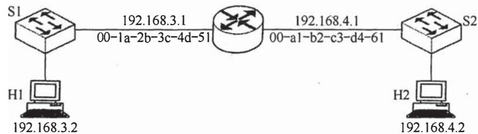

# 2018 年真题 · 单项选择题 · 第 37 题

路由器 R 通过以太网交换机 S1 和 S2 连接两个网络，R 的接口、主机 H1 和 H2 的 IP 地址与 MAC 地址如下图所示。若 H1 向 H2 发送 1 个 IP 分组 P，则 H1 发出的封装 P 的以太网帧的目的 MAC 地址、H2 收到的封装 P 的以太网帧的源 MAC 地址分别是 ____。

00-1a-2b-3c-4d-52
00-a1-b2-c3-d4-62

A. 00-a1-b2-c3-d4-62, 00-1a-2b-3c-4d-52  
B. 00-a1-b2-c3-d4-62, 00-a1-b2-c3-d4-61  
C. 00-1a-2b-3c-4d-51, 00-1a-2b-3c-4d-52  
D. 00-1a-2b-3c-4d-51, 00-a1-b2-c3-d4-61
