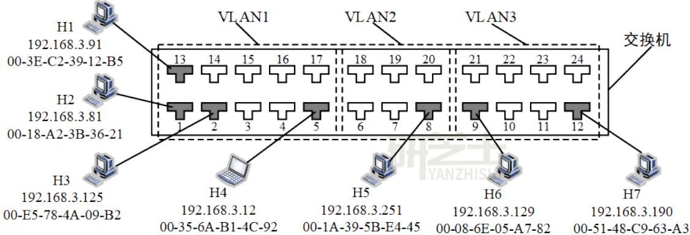

# 2024 年真题 · 单项选择题 · 第 35 题

如题 35 图所示的支持 VLAN 划分的交换机，已按端口划分了 3 个 VLAN，部分端口连接主机的 IP 地址和 MAC 地址如图中所示，ARP 表结构为\<IP 地址，MAC 地址，TTL\>。下列选项中，不会出现在 H4 的 ARP 表中的是（）。

A. 192.168.3.81, 00-18-A2-3B-36-21, 14: 32:00  
B. 192.168.3.91, 00-3E-C2-39-12-B5, 14: 37:00  
C. 192.168.3.125, 00-E5-78-4A-09-B2, 14:45:00  
D. 192.168.3.129, 00-08-6E-05-A7-82, 14:52:00

题35图

**答案**：D
