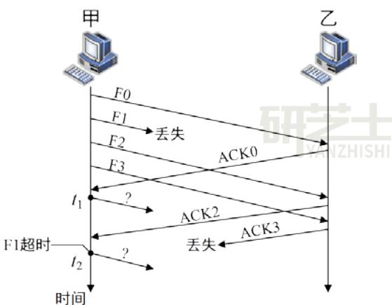

# 2024 年真题 · 单项选择题 · 第 37 题

主机甲通过选择重传(SR)滑动窗口协议向主机乙发送帧的部分过程如题 37 图所示, Fx 为数据帧, ACKx 为确认帧, x 是位数为 3 比特的序号。乙只对正确接收的数据帧进行独立确认, 发送窗口与接收窗口大小相同且均为最大值。甲在 $t_1$ 时刻和 $t_2$ 时刻发送的数据帧分别是（）。

题37图

A. F1，F3  
B. F1，F4  
C. F3，F1  
D. F4，F1

**答案**：D
