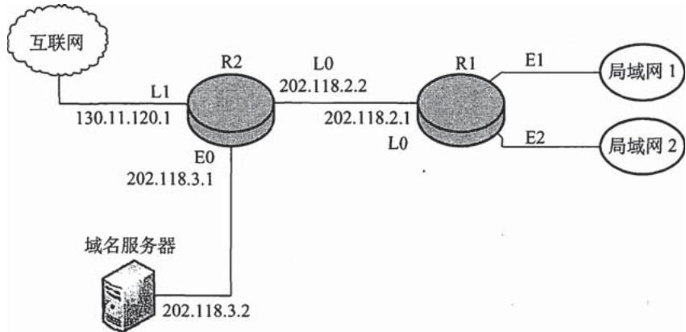

# 2009 年真题 · 综合应用题 · 第 47 题

（9分）某网络拓扑如下图所示，路由器R1通过接口E1、E2分别连接局域网1、局域网2，通过接口L0连接路由器R2，并通过路由器R2连接域名服务器与互联网。R1的L0接口的IP地址是202.118.2.1，R2的L0接口的IP地址是202.118.2.2，L1接口的IP地址是130.11.120.1，E0接口的IP地址是202.118.3.1，域名服务器的IP地址是202.118.3.2。

R1和R2的路由表结构为

<table><tr><td>目的网络 IP 地址</td><td>子网掩码</td><td>下一跳 IP 地址</td><td>接口</td></tr></table>

1）将 IP 地址空间 202.118.1.0/24 划分为 2 个子网，分别分配给局域网 1、局域网 2，每个局域网需分配的 IP 地址数不少于 120 个。请给出子网划分结果，说明理由或给出必要的计算过程。

2）请给出 R1 的路由表，使其明确包括到局域网 1 的路由、局域网 2 的路由、域名服务器的主机路由和互联网的路由。

3）请采用路由聚合技术，给出 R2 到局域网 1 和局域网 2 的路由。
