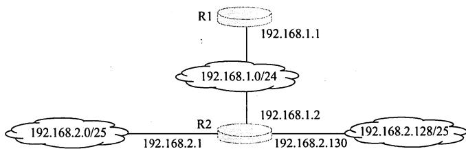

# 2011 年真题 · 单项选择题 · 第 37 题

某网络拓扑如下图所示，路由器 R1 只有到达子网 192.168.1.0/24 的路由。为使 R1 可以将 IP 分组正确地路由到图中所有的子网，则在 R1 中需要增加的一条路由（目的网络，子网掩码，下一跳）是 ____。

A. 192.168.2.0 255.255.255.128 192.168.1.1  
B. 192.168.2.0 255.255.255.0 192.168.1.1  
C. 192.168.2.0 255.255.255.128 192.168.1.2  
D. 192.168.2.0 255.255.255.0 192.168.1.2
