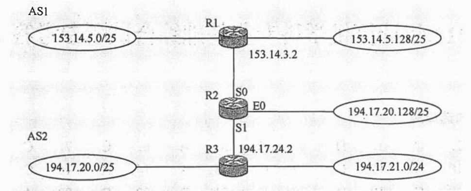

# 2013 年真题 · 综合应用题 · 第 47 题

（9分）假设 Internet 的两个自治系统构成的网络如题 47 图所示，自治系统 AS1 由路由器 R1 连接两个子网构成；自治系统 AS2 由路由器 R2、R3 互联并连接 3 个子网构成。各子网地址、R2 的接口名、R1 与 R3 的部分接口 IP 地址如题 47 图所示。

题 47 图 网络拓扑结构

请回答下列问题。

（1）假设路由表结构如下表所示。请利用路由聚合技术，给出 R2 的路由表，要求包括到达题 47 图中所有子网的路由，且路由表中的路由项尽可能少。

<table><tr><td>目的网络</td><td>下一跳</td><td>接口</td></tr></table>

（2）若 R2 收到一个目的 IP 地址为 194.17.20.200 的 IP 分组，R2 会通过哪个接口转发该 IP 分组？

（3）R1 与 R2 之间利用哪个路由协议交换路由信息？该路由协议的报文被封装到哪个协议的分组中进行传输？
