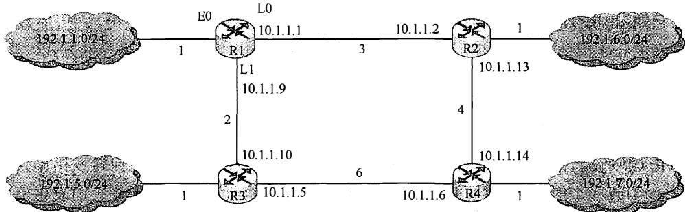

# 2014 年真题 · 综合应用题 · 第 43 题

（9 分）请根据题 42 描述的网络，继续回答下列问题。

题 42 图

1）假设路由表结构如下表所示，请给出题42图中R1的路由表，要求包括到达题42图中子网192.1.x.x的路由，且路由表中的路由项尽可能少。

<table><tr><td>目的网络</td><td>下一跳</td><td>接口</td></tr></table>

2）当主机192.1.1.130向主机192.1.7.211发送一个 $\mathrm{TTL} = 64$ 的IP分组时，R1通过哪个接口转发该IP分组？主机192.1.7.211收到的IP分组TTL是多少？

3）若 R1 增加一条 Metric 为 10 的链路连接 Internet，则题 42 表中 R1 的 LSI 需要增加哪些信息？
