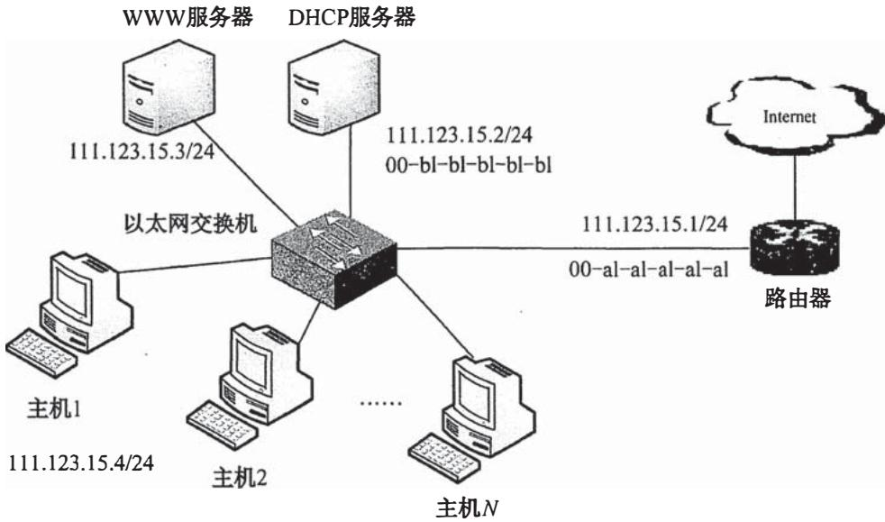

# 2015 年真题 · 综合应用题 · 第 47 题

（9 分）某网络拓扑如下图所示，其中路由器内网接口、DHCP服务器、WWW服务器与主机1均采用静态IP地址配置，相关地址信息见图中标注；主机2～主机N通过DHCP服务器动态获取IP地址等配置信息。

请回答下列问题。

1）DHCP 服务器可为主机 2～主机 N 动态分配 IP 地址的最大范围是什么？主机 2 使用 DHCP 协议获取 IP 地址的过程中，发送的封装 DHCP Discover 报文的 IP 分组的源 IP 地址和目的 IP 地址分别是什么？

2）若主机 2 的 ARP 表为空，则该主机访问 Internet 时，发出的第一个以太网帧的目的 MAC 地址是什么？封装主机 2 发往 Internet 的 IP 分组的以太网帧的目的 MAC 地址是什么？

3）若主机 1 的子网掩码和默认网关分别配置为 255.255.255.0 和 111.123.15.2，则该主机是否能访问 WWW 服务器？是否能访问 Internet？请说明理由。
