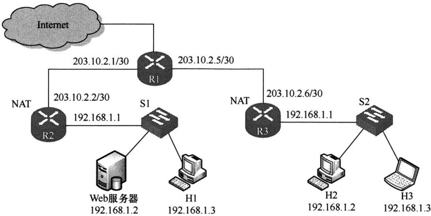

# 2020 年真题 · 综合应用题 · 第 47 题

（9 分）某校园网有两个局域网，通过路由器 R1、R2 和 R3 互联后接入 Internet，S1 和 S2 为以太网交换机。局域网采用静态 IP 地址配置，路由器部分接口以及各主机的 IP 地址如下图所示。

假设 NAT 转换表结构为

<table><tr><td colspan="2">外网</td><td colspan="2">内网</td></tr><tr><td>IP 地址</td><td>端口号</td><td>IP 地址</td><td>端口号</td></tr><tr><td></td><td></td><td></td><td></td></tr></table>

请回答下列问题:

1）为使 H2 和 H3 能够访问 Web 服务器（使用默认端口号），需要进行什么配置？

2）若 H2 主动访问 Web 服务器时, 将 HTTP 请求报文封装到 IP 数据报 P 中发送, 则 H2 发送 P 的源 IP 地址和目的 IP 地址分别是什么? 经过 R3 转发后, P 的源 IP 地址和目的 IP 地址分别是什么? 经过 R2 转发后, P 的源 IP 地址和目的 IP 地址分别是什么?
