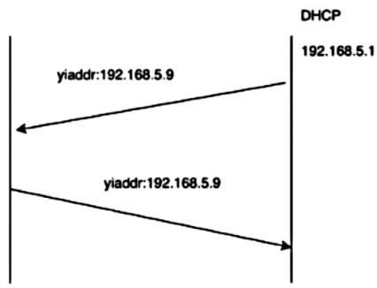

# 2025 年真题 · 单项选择题 · 第 36 题

一台新接入网络的主机 H 通过 DHCP 服务器动态请求 IP 地址过程中，与 DHCP 服务器交换 DHCP 报文过程如下图所示。封装 DHCP 的 REQUEST 报文的 IP 数据报的目的 IP 地址和源 IP 地址分别是

A. 192.168.5.1,0.0.0.0  
B. 192.168.5.1,192.168.5.9  
C. 255.255.255.255,0.0.0.0  
D. 255.255.255.255,192.168.5.9
