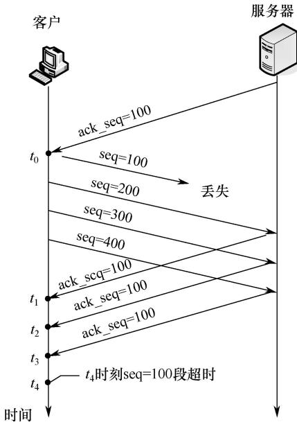

# 2019 年真题 · 单项选择题 · 第 38 题

某客户通过一个 TCP 连接向服务器发送数据的部分过程如题 38 图所示。客户在 $t_0$ 时刻第一次收到确认序列号 ack_seq = 100 的段，并发送序列号 seq = 100 的段，但发生丢失。若 TCP 支持快速重传，则客户重新发送 seq = 100 段的时刻是 ____。

题38图

A. $t_1$  
B. $t_2$  
C. $t_3$  
D. $t_4$
