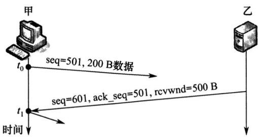

# 2021 年真题 · 单项选择题 · 第 40 题

设主机甲通过 TCP 向主机乙发送数据, 部分过程如下图所示。甲在 $t_0$ 时刻发送一个序号 $\mathrm{seq} = 501$ 、封装 $200 \mathrm{~B}$ 数据的段, 在 $t_1$ 时刻收到乙发送的序号 $\mathrm{seq} = 601$ 、确认序号 ack_seq = 501、接收窗口 rcvwnd = 500B 的段, 则甲在未收到新的确认段之前, 可以继续向乙发送的数据序号范围是 ( ) 。

A. $501 \sim 1000$  
B. $601 \sim 1100$  
C. $701 \sim 1000$  
D. $801 \sim 1100$
