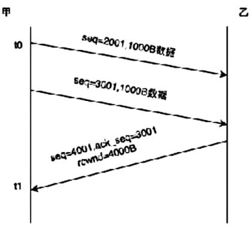

# 2025 年真题 · 单项选择题 · 第 38 题

主机甲通过 TCP 向主机乙发送数据的部分过程如下图，seq 为序号，ack-seq 为确认序号，rcwnd 为接收窗口。甲在 $t_0$ 时刻的拥塞窗口和发送窗口均为 2000B，拥塞控制阈值为 8000B，MSS=1000B。甲始终以 MSS 发送 TCP 段。若甲在 $t_1$ 时刻收到如图所示的确认段，则甲在未收到新的确认段之前，还可以继续向乙发送的 TCP 段数是

A. 2  
B. 3  
C. 4  
D. 5
