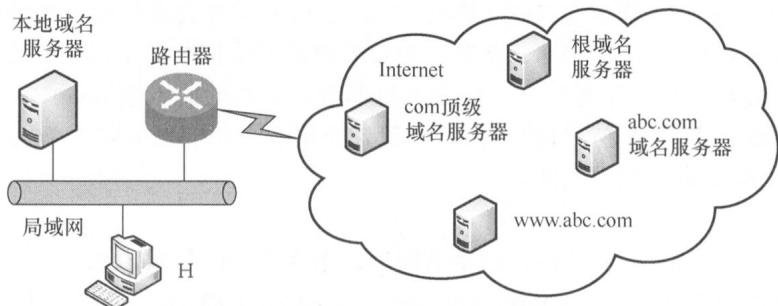

# 2020 年真题 · 单项选择题 · 第 40 题

假设下图所示网络中的本地域名服务器只提供递归查询服务，其他域名服务器均只提供迭代查询服务；局域网内主机访问 Internet 上各服务器的往返时间（RTT）均为 10ms，忽略其他各种时延。若主机 H 通过超链接 <http://www.abc.com/index.html> 请求浏览纯文本 Web 页 index.html，则从点击超链接开始到浏览器接收到 index.html 页面为止，所需的最短时间与最长时间分别是____。

A. 10ms, 40ms  
B. 10ms, 50ms  
C. 20ms, 40ms  
D. 20ms, 50ms
