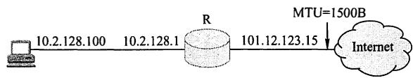
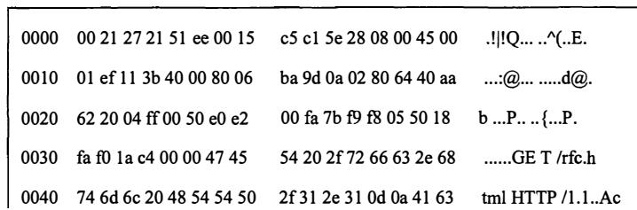
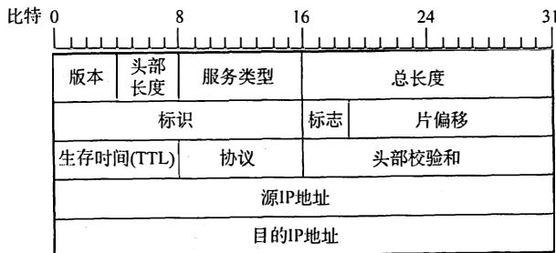

# 2011 年真题 · 综合应用题 · 第 47 题

（9 分）某主机的 MAC 地址为 00-15-C5-C1-5E-28，IP 地址为 10.2.128.100（私有地址）。题 47-a 图是网络拓扑，题 47-b 图是该主机进行 Web 请求的 1 个以太网数据帧前 80B 的十六进制及 ASCII 码内容。

题47-a图 网络拓扑

题 47-b 图 以太网数据帧（前 80B）

请参考图中的数据回答以下问题。

（1）Web 服务器的 IP 地址是什么？该主机的默认网关的 MAC 地址是什么？

（2）该主机在构造题47-b图的数据帧时，使用什么协议确定目的MAC地址？封装该协议请求报文的以太网帧的目的MAC地址是什么？

（3）假设 HTTP/1.1 协议以持续的非流水线方式工作，一次请求-响应时间为 RTT，rfc.html 页面引用了 5 个 JPEG 小图像，则从发出题 47-b 图中的 Web 请求开始到浏览器收到全部内容为止，需要多少个 RTT？

（4）该帧所封装的 IP 分组经过路由器 R 转发时，需修改 IP 分组头中的哪些字段？

注：以太网数据帧结构和 IP 分组头结构分别如题 47-c 图、题 47-d 图所示。

| 6B | 6B | 2B | 46-1500B | 4B |
| --- | --- | --- | --- | --- |
| 目的 MAC 地址 | 源 MAC 地址 | 类型 | 数据 | CRC |

题 47-c 图 以太网帧结构

题 47-d 图 IP 分组头结构
