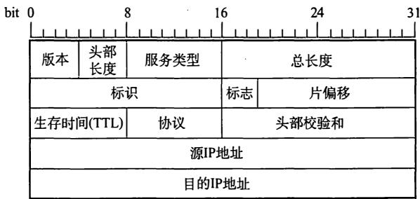
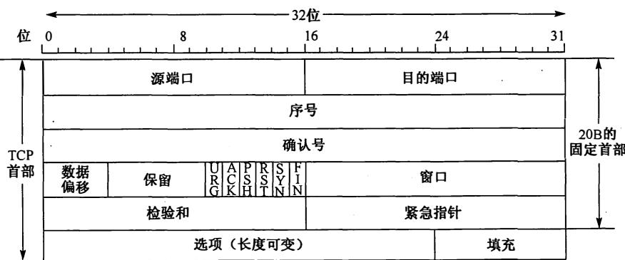

# 2012 年真题 · 综合应用题 · 第 47 题

主机 H 通过快速以太网连接 Internet，IP 地址为 192.168.0.8，服务器 S 的 IP 地址为 211.68.71.80。H 与 S 使用 TCP 通信时，在 H 上捕获的其中 5 个 IP 分组如题 47-a 表所示。

题47-a表

<table><tr><td>编号</td><td colspan="5">IP 分组的前 40 字节内容(十六进制)</td></tr><tr><td rowspan="2">1</td><td>45 00 00 30</td><td>01 9b 40 00</td><td>80 06 1d e8</td><td>c0 a8 00 08</td><td>d3 44 47 50</td></tr><tr><td>0b d9 13 88</td><td>84 6b 41 c5</td><td>00 00 00 00</td><td>70 02 43 80</td><td>5d b0 00 00</td></tr><tr><td rowspan="2">2</td><td>43 00 00 30</td><td>00 00 40 00</td><td>31 06 6e 83</td><td>d3 44 47 50</td><td>c0 a8 00 08</td></tr><tr><td>13 88 0b d9</td><td>e0 59 9f ef</td><td>84 6b 41 c6</td><td>70 12 16 d0</td><td>37 e1 00 00</td></tr><tr><td rowspan="2">3</td><td>45 00 00 28</td><td>01 9c 40 00</td><td>80 06 1d ef</td><td>c0 a8 00 08</td><td>d3 44 47 50</td></tr><tr><td>0b d9 13 88</td><td>84 6b 41 c6</td><td>e0 59 9f f0</td><td>50 f0 43 80</td><td>2b 32 00 00</td></tr><tr><td rowspan="2">4</td><td>45 00 00 38</td><td>01 9d 40 00</td><td>80 06 1d de</td><td>c0 a8 00 08</td><td>d3 44 47 50</td></tr><tr><td>0b d9 13 88</td><td>84 6b 41 c6</td><td>e0 59 9f f0</td><td>50 18 43 80</td><td>e6 55 00 00</td></tr><tr><td rowspan="2">5</td><td>45 00 00 28</td><td>68 11 40 00</td><td>31 06 06 7a</td><td>d3 44 47 50</td><td>c0 a8 00 08</td></tr><tr><td>13 88 0b d9</td><td>e0 59 9f f0</td><td>84 6b 41 d6</td><td>50 10 16 d0</td><td>57 d2 00 00</td></tr></table>

回答下列问题。

1）题47-a表中的IP分组中，哪几个是由H发送的？哪几个完成了TCP连接建立过程？哪几个在通过快速以太网传输时进行了填充？

2）根据题47-a表中的IP分组，分析S已经收到的应用层数据字节数是多少？

3） 若题 47-a 表中的某个 IP 分组在 S 发出时的前 40 字节如题 47-b 表所示，则该 IP 分组到达 H 时经过了多少个路由器？

题 47-b 表

<table><tr><td rowspan="2">来自S的分组</td><td>45 00 00 28</td><td>68 11 40 00</td><td>40 06 ec ad</td><td>d3 44 47 50</td><td>ca 76 01 06</td></tr><tr><td>13 88 a1 08</td><td>e0 59 9f f0</td><td>84 6b 41 d6</td><td>50 10 16 d0</td><td>b7 d6 00 00</td></tr></table>

注：IP 分组头和 TCP 段头结构分别如题 47-a 图和题 47-b 图所示。

题 47-a 图 IP 分组头结构

题 47-b 图 TCP 段头结构
