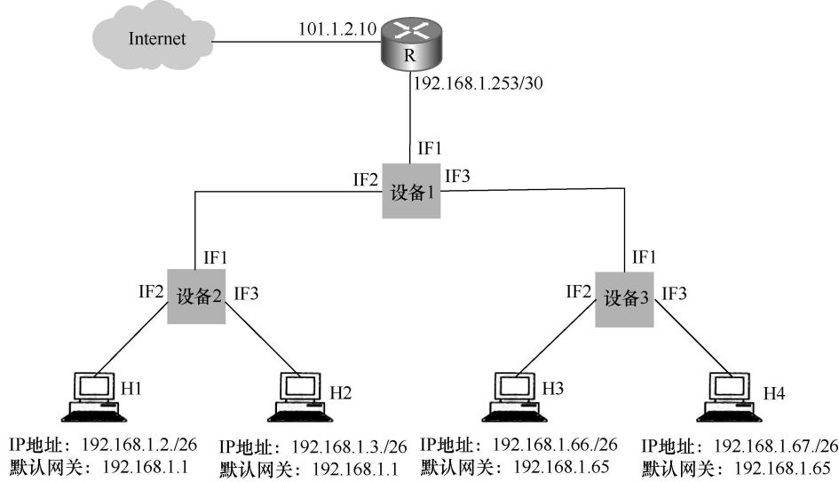

# 2019 年真题 · 综合应用题 · 第 47 题

（9 分）某网络拓扑如题 47 图所示，其中 R 为路由器，主机 H1～H4 的 IP 地址配置以及 R 的各接口 IP 地址配置如图中所示。现有若干以太网交换机（无 VLAN 功能）和路由器两类网络互连设备可供选择。

题47图

请回答下列问题:

（1）设备 1、设备 2 和设备 3 分别应选择什么类型的网络设备？

（2）设备 1、设备 2 和设备 3 中，哪几个设备的接口需要配置 IP 地址？为对应的接口配置正确的 IP 地址。

（3）为确保主机 H1～H4 能够访问 Internet，R 需要提供什么服务？

（4）若主机 H3 发送一个目的地址为 192.168.1.127 的 IP 数据报，网络中哪几个主机会接收该数据报？
