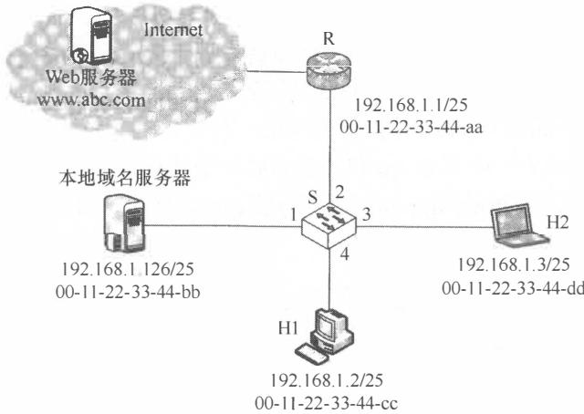

# 2021 年真题 · 综合应用题 · 第 47 题

（9分）某网络拓扑如题47图所示，以太网交换机S通过路由器R与Internet互联。路由器部分接口、本地域名服务器、H1、H2的IP地址和MAC地址如图中所示。在 $t_0$ 时刻H1的ARP表和S的交换表均为空，H1在此刻利用浏览器通过域名www.abc.com请求访问Web服务器，在 $t_1$ 时刻 $(t_1 > t_0)$ S第一次收到了封装HTTP请求报文的以太网帧，假设从 $t_0$ 到 $t_1$ 期间网络未发生任何与此次Web访问无关的网络通信。

题 47 图

请回答下列问题。

1）从 $t_0$ 到 $t_1$ 期间，H1除了HTTP之外还运行了哪个应用层协议？从应用层到数据链路层，该应用层协议报文是通过哪些协议进行逐层封装的？

2）若S的交换表结构为\<MAC地址，端口\>，则 $t_1$ 时刻S交换表的内容是什么？

3）从 $t_{0}$ 到 $t_{1}$ 期间，H2 至少会接收到几个与此次 Web 访问相关的帧？接收到的是什么帧？帧的目的 MAC 地址是什么？
