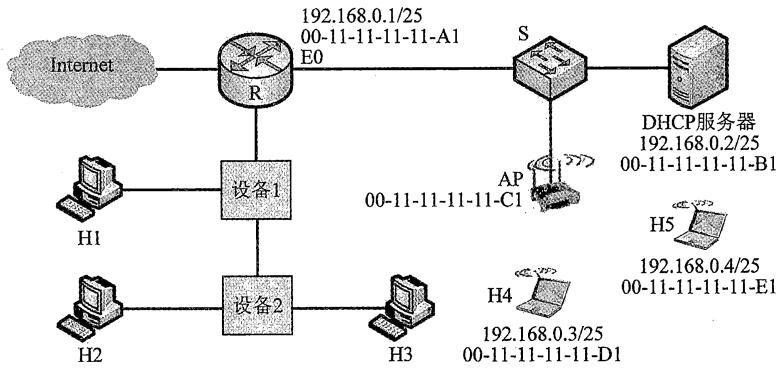

# 2022 年真题 · 综合应用题 · 第 47 题

（9分）某网络拓扑如题47图所示，R为路由器，S为以太网交换机，AP是802.11接入点，路由器的E0接口和DHCP服务器的IP地址配置如图中所示；H1与H2属于同一个广播域，但不属于同一个冲突域；H2和H3属于同一个冲突域；H4和H5已经接入网络，并通过DHCP动态获取了IP地址。现有路由器、100BaseT以太网交换机和100BaseT集线器（Hub）三类设备各若干台。

题47图

请回答下列问题。

1）设备1和设备2应该分别选择哪类设备？

2）若信号传播速度为 $2 \times 10^{8}$ m/s，以太网最小帧长为 64 B，信号通过设备 2 时会产生额外的 $1.51 \mu s$ 的时间延迟，则 H2 与 H3 之间可以相距的最远距离是多少？

3）在 H4 通过 DHCP 动态获取 IP 地址过程中，H4 首先发送了 DHCP 报文 M，M 是哪种 DHCP 报文？路由器 E0 接口能否收到封装 M 的以太网帧？S 向 DHCP 服务器转发的封装 M 的以太网帧的目的 MAC 地址是什么？

4）若 H4 向 H5 发送一个 IP 分组 P，则 H5 收到的封装 P 的 802.11 帧的地址 1、地址 2 和地址 3 分别是什么？
