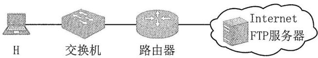

# 2023 年真题 · 综合应用题 · 第 47 题

(9 分) 某网络拓扑如下图所示, 主机 H 登录到 FTP 服务器后, 向服务器上传一个大小为 $18000 \mathrm{~B}$ 的文件 F。假设 H 为传输 F 建立数据连接时, 选择的初始序号为 100, $\mathrm{MSS} = 1000 \mathrm{~B}$ , 拥塞控制的初始阈值是 4MSS, $\mathrm{RTT} = 10 \mathrm{~ms}$ , 忽略 TCP 的传输时延; 在 F 的传输过程中, H 均以 MSS 段向服务器发送数据, 且未发生差错、丢包和乱序现象。

请回答下列问题。

(1) FTP 的控制连接是持久的还是非持久的？FTP 的数据连接是持久的还是非持久的？H 登录 FTP 服务器时，建立的 TCP 连接是控制连接还是数据连接？

(2) H 通过数据连接发送 F 时, F 的第一个字节序号是多少? 在断开数据连接的过程中, FTP 服务器发送的第二次挥手 ACK 段的确认序号是多少?

(3) H 通过数据连接发送 F 的过程中, 当 H 收到确认序号为 2101 的确认时, H 的拥塞窗口调整为多少? 收到确认序号为 7101 的确认段时, H 的拥塞窗口调整为多少?

(4) H 从请求建立数据连接开始, 到确认 F 已被服务全部接收为止, 至少需要多长时间? 在这期间应用层数据的平均发送速率是多少?
