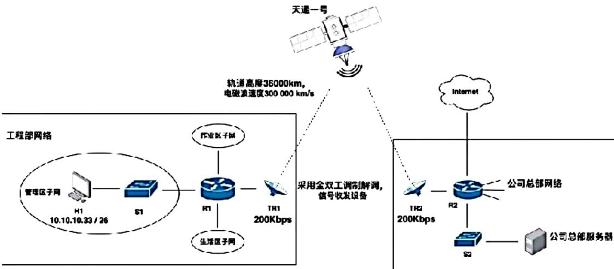

# 2025 年真题 · 综合应用题 · 第 47 题

（本题9分）

如题47图所示，卫星天通一号的轨道高度是 $36000\mathrm{km}$ ，电磁波传播速度为 $300000\mathrm{km / s}$ 。TR1和TR2用于收发卫星信号，采用全双工调制解调，其收发速率为200Kbps。

题47图

请回答下列问题，并说明理由。

（1）忽略卫星信号中继，TR1，TR2调制解调开销，则R1到R2之间的卫星链路单向传播时延是多少？主机H向总部服务器传输数据时可达到的最大吞吐量是多少？若忽略各层协议首部开销，以及以太网的传播时延，则 $\mathrm{H}\rightarrow$ server 上传一个 4000B 的文件，至少需要多长时间？（3分）

（2）基于GBN为卫星链路设计单向可靠的链路层协议SLP，支持 $\mathrm{R1}\rightarrow \mathrm{R2}$ 发送数据。SLP数据帧长1500B，忽略ACK帧长度，要求SLP单向信道利用率不低于 $80\%$ ，则发送窗口至少为多少？SLP帧序号至少为多少？（3分）

（3）总部给工程部分配IP地址空间10.10.10.0/24，再划分为3个子网，生活区子网不少于120个，作业子网，管理区子网IP均不少于60个，H已正确配置IP。问作业区子网，管理区子网，生活区子网地址各是多少？（3分）
