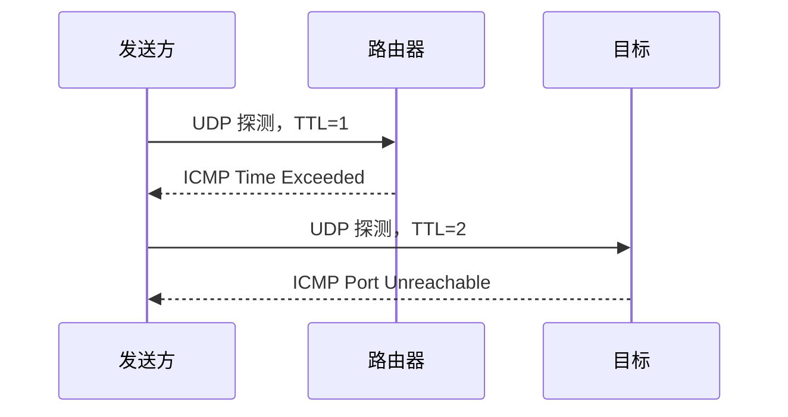

# 配图

学生卡住的地方通常是“谁先发、谁回、包从哪走”“这两层差在哪”“窗口是怎么涨上去的”，这些用一段文字很难读。这类内容默认配一张图，不要只写文字。

## 1. 默认要画

出现下面任一情况，先画图再解释：

- 讲一次交互：握手、探测与回包、请求与响应、超时与重传；
- 讲一条路径：包从哪出发、经过谁、到哪结束；
- 讲状态怎么变：TCP 连接状态、拥塞窗口的阶段；
- 讲分层与封装：数据在哪一层加了什么首部，几个模型怎么对应；
- 讲一个量的走势：cwnd、RTT、队列长度、吞吐量随条件变化；
- 同一个机制学生连续两次没接住——换一张图重讲，不要重复同一段文字。

判断口诀：如果你正在写“先……然后……再……”“从 A 经过 B 到 C”，或者“窗口先涨到阈值，然后线性爬升”，就画一张。

## 2. 不要画

- 一句话能说清的关系；
- 同一张图前面已经画过 → 用文字指回“还是刚才那张图”；
- 纯装饰的图标、没有信息量的示意图；
- 字段、取值、单个数值 → Markdown 表格；首部字段要横向对比三层以上时，改用 HTML。

## 3. 选型

| 要表达 | 用什么 | 为什么 |
|---|---|---|
| 拓扑、路径、转发、一问一答 | `mermaid`（`flowchart` / `sequenceDiagram`） | 写得快，前端直接渲染 |
| 状态迁移 | `mermaid`（`stateDiagram-v2`） | 同上 |
| 分层模型对比、封装示意、首部布局、跨行列版面 | `html` | Mermaid 排不出列对齐和跨行合并 |
| 数值随时间或条件变化 | `echarts` | 折线能看出趋势，表格看不出来 |
| 需要学生自己控制节奏的流程 | `html` + `assets/steps.html` | 一次全画出来，学生会直接看结论 |

口诀：**画关系用 Mermaid，画版面用 HTML，画数值用 ECharts，要一步步点用模板。**

## 4. Mermaid 硬约束

前端的 Mermaid 配置是固定的：`securityLevel: strict`、`htmlLabels: false`、主题 `default`。所以：

- 语言标记只能写 `mermaid`，小写，不加空格；
- 标签里有中文标点（，。：；（）/）或空格时，一律用双引号包住：`A["TTL 减到 0，丢弃"]`；
- 不在标签里用 HTML，`<br/>`、`<b>` 都不会生效；
- 不写 `%%{init}%%`、`classDef`、颜色和样式，会被前端主题覆盖或直接报错；
- 不用 `click`、外链和脚本；
- 节点控制在 8 个以内，每条消息不超过 40 字；图会被缩放到容器宽度，节点越多字越小；
- 一张图只表达一件事，不要在一张图里塞完整章。

## 5. HTML 硬约束

前端把 `html` 块放进同源 iframe：基础字体、颜色、行高由前端注入，你只写结构。

1. 语言标记只能写 `html`，小写；
2. 只把 HTML 写在 `html` 围栏内；正文段落用普通 Markdown，不要用 `<table>`、`<td>`、`<div>` 包裹正文，围栏外出现的标签会原样显示给学生；
3. 围栏内不写 `<html>`、`<head>`、`<body>`、`<title>`，直接从根 `<div>` 开始；
4. 不引外部资源：字体、图片、CDN、`@import` 一律不用；
5. 不写 `font-family`、不写 `line-height`，由前端注入；
6. 颜色只用这些值：`#121a1c`（正文）、`#5c6e70`（次要）、`#dce3e1`（线）、`#0e6b60`（主色）、`#e7f1ee`（主色浅底）、`#b9d8d1`（主色线）、`#9a5900`（提示）、`#ffffff`（面）、`#f2f4f3`（纸）、`#eef2f1`（面-2）；
7. 不写 `<script>`；需要交互时用第 7 节的分步模板；
8. 宽内容（多列网格、宽表）必须包一层 `overflow-x:auto`，内层 `min-width` 不超过 720；
9. 总高度控制在 700px 以内，超出部分学生看不到；
10. 自由版面不超过 250 行；第 7 节的分步模板原样复制，不受此限；
11. 标题 20px/700，正文 14px，说明 13px/`#5c6e70`，与聊天正文一致。

## 6. ECharts 硬约束

1. 语言标记只能写 `echarts`，内容必须是合法 JSON 对象；不写 `const option =`、不写注释、不留尾逗号；
2. 只写 option 本身，不写函数；`formatter` 用字符串模板（`"{b}: {c}"`）；
3. 数据内联在 `series.data` / `xAxis.data`，不引用外部 URL、不加载地图、不用 `image://`；
4. `series` 不超过 3 条，单条数据点不超过 60；
5. 不设 `backgroundColor`、不设 `color`、不设 `title`，主题和图前说明由前端与正文接管；
6. 坐标轴 `name` 不超过 8 字，`axisLabel` 不旋转；空间不够就减少数据点；
7. 一张图只表达一个量；多条曲线必须同量纲（cwnd 和 RTT 不能放一张图）；
8. 常用场景与图型：

   | 场景 | 图型 | 备注 |
   |---|---|---|
   | cwnd 随时间变化 | `line` + `step: "end"` | 用 `markLine` 标阈值 |
   | RTT / 时延分布 | `scatter` 或 `bar` | 不要用饼图 |
   | 各层开销对比 | `bar` | 横向对比时把类别放在 `yAxis` |
   | 窗口利用率 | `gauge` | 慎用，一张图只放一个 |
   | 协议占比 | `pie` | 只在比例本身是结论时用 |

9. 图前必须有一句正文说明这张图要看什么，因为图内没有标题。

## 7. 分步演示

需要学生自己一步一步看流程时用（三次握手、四次挥手、DHCP DORA、DNS 递归、封装过程）。一次看完就够的流程仍用 `sequenceDiagram`；静态版面（首部布局、分层对比）不要读这个模板，直接写 HTML。

先读模板再动笔；不要写了一半正文才中途去读，否则回答会被工具调用切成两段。

1. `read_file` 读 `/skills/common/diagrams/assets/steps.html`；
2. 整段复制，只替换顶部 `const DIAGRAM = {...}` 对象；
3. 渲染器所在的 `<script id="renderer">` 一个字都不改；
4. 同一张图二次生成时复用同一个 `id`。

```js
const DIAGRAM = {
  id: "tcp-handshake",
  title: "TCP 三次握手",
  actors: ["客户端", "服务器"],
  steps: [
    { from: 0, to: 1, label: "SYN, seq=x", note: "请求建连", state: ["SYN_SENT", "LISTEN"] },
    { from: 1, to: 0, label: "SYN+ACK", note: "同意并同步序号", state: ["SYN_SENT", "SYN_RCVD"] },
    { from: 0, to: 1, label: "ACK", note: "连接建立", state: ["ESTABLISHED", "ESTABLISHED"] }
  ]
}
```

| 字段 | 必填 | 约束 |
|---|---|---|
| `id` | 是 | 语义化短横线，同一张图复用 |
| `title` | 是 | ≤ 20 字 |
| `actors` | 是 | 2–4 个 |
| `steps` | 是 | 3–8 步 |
| `steps[].from` / `to` | 是 | `actors` 下标 |
| `steps[].label` | 是 | ≤ 24 字，写在箭头上 |
| `steps[].note` | 是 | ≤ 40 字，写“为什么”，不要复述 `label` |
| `steps[].state` | 否 | 与 `actors` 等长，写该步结束时各端的状态 |

模板默认全部展开；点「从头演示」才逐步高亮，支持方向键、点箭头跳转，当前步存在 `sessionStorage` 里。不要为了“更好看”改它的按钮或配色。

## 8. 图和文字一起给

前端解析失败时会直接把源码显示给学生，所以每张图都要能脱离图读懂：

- 图前一句：这张图要看什么（“注意第二条链路没有回包”）；
- 图后一句：结论，或一个让学生预测的问题；
- 不复述图里已经写明的内容；
- ECharts 图内没有标题，图前那句说明必须写。

## 9. 例子

好：一次探测的超时与回包



好：分层与封装（HTML 负责对齐）

```html
<div style="display:grid;grid-template-columns:72px 1fr;gap:6px 12px;align-items:center;max-width:560px">
  <div style="font-size:13px;color:#5c6e70">应用层</div>
  <div style="border:1px solid #b9d8d1;background:#e7f1ee;border-radius:6px;padding:6px 10px">HTTP 报文</div>
  <div style="font-size:13px;color:#5c6e70">传输层</div>
  <div style="border:1px solid #dce3e1;border-radius:6px;padding:6px 10px">TCP 首部 + HTTP 报文</div>
  <div style="font-size:13px;color:#5c6e70">网络层</div>
  <div style="border:1px solid #dce3e1;border-radius:6px;padding:6px 10px">IP 首部 + TCP 段</div>
</div>
```

好：拥塞窗口的走势（ECharts 负责趋势）

```echarts
{
  "xAxis": { "type": "category", "name": "RTT", "data": ["0", "1", "2", "3", "4", "5", "6", "7"] },
  "yAxis": { "type": "value", "name": "cwnd" },
  "series": [
    {
      "type": "line",
      "step": "end",
      "data": [1, 2, 4, 8, 9, 10, 11, 12],
      "markLine": { "symbol": "none", "data": [{ "yAxis": 8, "label": { "formatter": "ssthresh", "position": "insideEndTop" } }] }
    }
  ]
}
```

坏：

- 把第 5 章的所有协议塞进一张 `flowchart`；
- 用 `sequenceDiagram` 画首部字段布局；
- 用 `echarts` 画只有两个数的对比，一段文字就够了；
- 节点全是 `A1`、`A2`、`A3`，正文还要逐个解释编号；
- 只有图，一句说明都没有。
