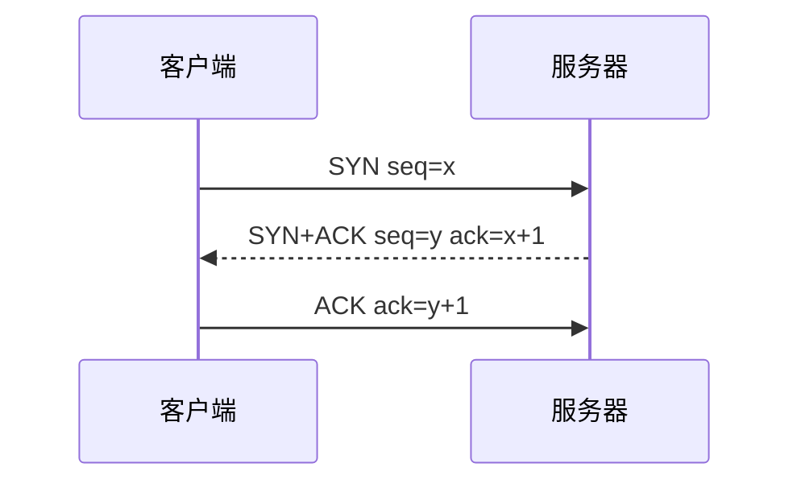
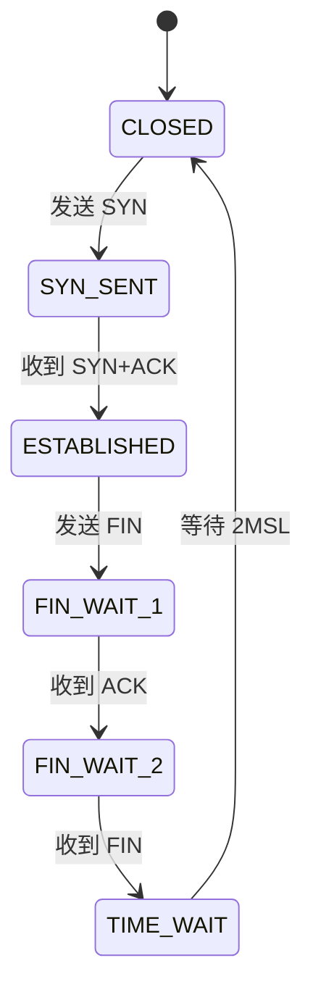
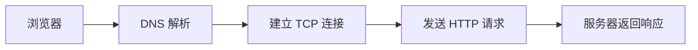

# 配图

图不是装饰。它把"谁先谁后、差在哪、怎么变的"从文字里拎出来，让学生少读一段话就明白。一张图只回答一个问题；回答不了就别画。

## 1. 要不要画

命中就画：

- 学生要同时记住三个以上元素的关系；
- 顺序本身就是考点：握手、封装、路由收敛、拥塞控制；
- 两个东西容易混：TCP 与 UDP、CSMA/CD 与 CSMA/CA、流量控制与拥塞控制；
- 一个量随条件变化，看文字看不出趋势。

不画：

- 一句话能说清；
- 只是术语解释，没有结构；
- 图里的信息正文马上会逐条讲完，图只是复述；
- 同一张图刚画过，用文字指回即可。

判断标准不是"内容多不多"，是"这张图能不能让这个学生少读一段文字就明白"。

## 2. 学生卡在哪 → 画什么

| 学生的困难 | 图式 | 载体 |
|---|---|---|
| 不知道谁先谁后、谁发给谁 | 时序 | `mermaid` sequenceDiagram |
| 不知道一个对象怎么在状态间变 | 状态迁移 | `mermaid` stateDiagram-v2 |
| 不知道数据或控制怎么流动 | 路径与流转 | `mermaid` flowchart |
| 不知道层次怎么叠、边界在哪 | 分层与封装 | `html` |
| 记不住报文长什么样、字段多宽 | 字段布局 | `html` |
| 分不清两个东西差在哪 | 并排对比 | `html` |
| 不知道一段时间内谁占着链路 | 时间轴 | `html` |
| 看不出量怎么随条件变 | 趋势曲线 | `echarts` |

## 3. 八个图式

**时序**（`mermaid` sequenceDiagram）：多角色按先后交互，重点是"谁先发给谁、换来了什么"。



`->>` 是请求，`-->>` 是响应，方向就是因果。只画一条正常路径，超时、丢包另起一张；序号计算留在正文。别用 flowchart 把三步画成三个框，角色没了。

**状态迁移**（`mermaid` stateDiagram-v2）：对象在状态间切换，重点是"什么事件触发哪次跳转"。



只画当前知识点涉及的那条路径，完整状态机不进一张图。转移标签写"事件 + 动作"，不是目标状态名。状态名保留英文，学生考试要认这些词。

**路径与流转**（`mermaid` flowchart）：数据或控制沿链路移动，重点是"经过哪些节点、在哪里被处理"。



节点 8 个以内，超过就拆图或降级为文字。有分支时把判断写在连线上：`A -->|"缓存命中"| B`。节点名用正文里的术语，不要 `A1`、`A2`。

**分层与封装**（`html`）：层次怎么叠、边界在哪、谁包住谁。用 `grid-template-columns:72px 1fr`，左列层名、右列该层看到的数据。封装写成"首部 + 上层内容"，本层首部用 `#e7f1ee` 底，其余白底。五层就画五层，七层只在专门讲 OSI 时画。别用 flowchart 画分层，连线会把层次画成流程。

**字段布局**（`html`）：报文长什么样、每个字段多宽。一行 32 位，列头写位范围，用 `grid-template-columns:40px 1fr 1fr`。只标正在讲的那几个字段，其余写 `…`，全标满等于没标。宽度用比例不用像素，外层包 `overflow-x:auto`，内层 `min-width` 不超过 720。别用 Mermaid 画字段表，位宽信息全丢。

**并排对比**（`html`）：两个东西容易混，重点是"差在哪一行"。用 `grid-template-columns:1fr 1fr`，左右两栏的每一行回答同一个维度。差异行用底色强调，相同点整行淡化或省略。两栏够了，三栏以上会挤，改纵向分组。别把两者各画一张图再让学生自己找不同，对比必须放同一张图里。

**时间轴**（`html`）：一段时间内谁占着链路、等了多久。每行用同一套列比例（如 `1fr 2fr 1fr`），色块表示"在发"，空白表示"在等"，关键时间点用竖线或数字标出。别用 flowchart 画时间轴，流程图没有"同时发生"和"等待时长"。

**趋势曲线**（`echarts`）：一个量随条件变化，重点是"什么时候涨、什么时候掉、拐点在哪"。

```echarts
{
  "xAxis": { "type": "category", "name": "RTT", "data": ["0", "1", "2", "3", "4", "5", "6", "7"] },
  "yAxis": { "type": "value", "name": "cwnd" },
  "series": [
    {
      "type": "line",
      "step": "end",
      "data": [1, 2, 4, 8, 9, 10, 11, 12],
      "markLine": { "symbol": "none", "data": [{ "yAxis": 8, "label": { "formatter": "ssthresh", "position": "insideEndTop" } }] },
      "markArea": {
        "data": [
          [{ "xAxis": "0", "name": "慢开始" }, { "xAxis": "3" }],
          [{ "xAxis": "3", "name": "拥塞避免" }, { "xAxis": "7" }]
        ]
      }
    }
  ]
}
```

拐点比曲线本身重要：`markLine` 标阈值，`markArea` 标阶段。一张图一个量，单位不同的曲线不要放一起。离散变化用 `step: "end"`。图前必须写一句说明，因为块内不写标题。

## 4. 画好一张图的五个决定

1. **图前那句话是断言，不是名词。** "TCP 三次握手"是目录；"第三次 ACK 丢了会怎样"才是图要回答的问题。写不出这句，说明还没想清楚画什么。
2. **只保留一层。** 同一件事有细节层、状态层、时序层。先定这一张画哪层，其余删掉。自检：删掉一半节点，结论还成立，就是画多了。
3. **一个视觉焦点。** 学生看完应该记住一处。HTML 用框和底色，ECharts 用 `markLine` / `markArea`，Mermaid 用图前那句话点名，其余降低存在感。处处强调等于没有强调。
4. **对比要并排，不要串成链。** 两个对象的差异，左右两栏逐行对齐；串成一条流程，学生得来回找。
5. **留一个预测点。** 讲到关键处停住，问"下一步会怎样"，再给答案。全画完的图只能看，不能想。

## 5. Mermaid 硬约束

前端配置固定：`securityLevel: strict`、`htmlLabels: false`、主题 `default`。

- 语言标记只能写 `mermaid`，小写；
- 标签含中文标点（，。：；（）/）或空格时，用双引号包住：`A["TTL 减到 0，丢弃"]`；
- 标签里不写 HTML，`<br/>`、`<b>` 都不生效；
- 不写 `%%{init}%%`、`classDef`、`style`、颜色，会被主题覆盖或直接报错；
- 不用 `click`、外链、脚本；
- 序列图消息文本里不要再出现冒号，`:` 是语法分隔符；
- 节点 8 个以内，参与者 2–4 个，消息 40 字以内。画布会缩放到容器宽度，节点越多字越小。

## 6. HTML 硬约束

前端把 `html` 块放进同源 iframe，基础字体、颜色、行高由前端注入。

- 不写 `<html>`、`<head>`、`<body>`、`<title>`，直接从根 `<div>` 开始，根 `<div>` 必须闭合；
- 不写 `<script>`；需要交互就用第 8 节的分步模板；
- 不写 `font-family`、不写 `line-height`；
- 颜色只用：`#121a1c`（正文）、`#5c6e70`（次要）、`#dce3e1`（线）、`#0e6b60`（主色）、`#e7f1ee`（主色浅底）、`#b9d8d1`（主色线）、`#9a5900`（提示）、`#ffffff`（面）、`#f2f4f3`（纸）、`#eef2f1`（面-2）；
- 字号：标题 20px/700，正文 14px，说明 13px/`#5c6e70`；圆角 6px，内边距 6–12px，间距 6–12px；
- 宽内容（多列网格、宽表）包一层 `overflow-x:auto`，内层 `min-width` 不超过 720；
- 总高度 700px 以内，超出部分学生看不到；
- 自由版面不超过 120 行，宁可删内容不要写长；第 8 节的分步模板原样复制，不受此限；
- 不引外部资源：字体、图片、CDN、`@import` 一律不用。

## 7. ECharts 硬约束

- 语言标记只能写 `echarts`，内容是一个合法 JSON 对象，只写 option 本身；
- 不写 `const option =`、不写注释、不留尾逗号；
- 不写函数，`formatter` 用字符串模板，例如 `"{b}: {c}"`；
- 数据内联在 `series.data` / `xAxis.data`，不引用外部 URL、不加载地图、不用 `image://`；
- 不设 `backgroundColor`、`color`、`title`，主题由前端接管；
- `series` 不超过 3 条，单条数据点不超过 60；
- 坐标轴 `name` 不超过 8 字，`axisLabel` 不旋转；
- 一张图一个量，多条曲线必须同量纲；
- 图型：随时间变化用 `line`（离散加 `step: "end"`），阶段用 `markArea`，阈值用 `markLine`；类别对比用 `bar`，类别多时放 `yAxis`；分布用 `scatter` 或 `bar`；占比只在比例本身是结论时用 `pie`。

## 8. 分步演示

多个角色按步骤推进、且每一步的"为什么"需要单独讲时用：协议交互、请求处理链路、算法执行步骤。

1. 先读模板再动笔：`materials_read("/.templates/step-demo.html")`，默认一次返回 300 行，足够；
2. 整段复制，只替换顶部 `const DIAGRAM = {...}` 对象；
3. `<script id="renderer">` 一个字都不改；
4. 同一张图二次生成时复用同一个 `id`。

```js
const DIAGRAM = {
  id: "tcp-handshake",
  title: "TCP 三次握手",
  actors: ["客户端", "服务器"],
  steps: [
    { from: 0, to: 1, label: "SYN, seq=x", note: "请求建连", state: ["SYN_SENT", "LISTEN"] },
    { from: 1, to: 0, label: "SYN+ACK", note: "同意并同步序号", state: ["SYN_SENT", "SYN_RCVD"] },
    { from: 0, to: 1, label: "ACK", note: "连接建立", state: ["ESTABLISHED", "ESTABLISHED"] }
  ]
}
```

| 字段 | 必填 | 约束 |
|---|---|---|
| `id` | 是 | 语义化短横线，同一张图复用 |
| `title` | 是 | ≤ 20 字，写机制名 |
| `actors` | 是 | 2–4 个，用正文里的称呼 |
| `steps` | 是 | 3–8 步 |
| `steps[].from` / `to` | 是 | `actors` 下标 |
| `steps[].label` | 是 | ≤ 24 字，写在箭头上，写报文或动作 |
| `steps[].note` | 是 | ≤ 40 字，写"为什么"，不要复述 `label` |
| `steps[].state` | 否 | 与 `actors` 等长，写该步结束时各端的状态 |

模板默认全部展开；点「从头演示」才逐步高亮，支持方向键、点箭头跳转，当前步存在 `sessionStorage` 里。不要为了"更好看"改它的按钮、配色或渲染逻辑。

一次能看完的流程用 `sequenceDiagram`；静态版面（字段布局、层次对比）不要用这个模板。

## 9. 图和文字怎么配

- 图前一句：这张图看什么。ECharts 必须在图前写，因为块内没有标题；
- 图后一句：结论，或一个让学生预测的问题；
- 不复述图里已经写明的内容；
- 两张图要分工：一张全景一张局部，或一张正常一张异常。同一层次的两张图等于画了两遍；
- 图要能脱离上下文读懂：节点名用正文里的术语，不要 `A1`、`A2`；
- 图上出现正文没解释的符号，就删符号或删图。

## 10. 画完自检

- 图前那句是问题或断言，还是名词？
- 删掉一半元素，结论还成立吗？成立就删；
- 学生的视线最后落在哪？如果落点不是重点，加标注；
- 这张图和上一张图说的是不是同一件事？是就合并或删掉一张；
- 一次回复超过两张图，先找出哪一张可以被一句话替代；
- 围栏成对、标签加引号、根标签闭合了吗？

## 11. 常见失败

- 把一章塞进一张 `flowchart`，学生看到的是目录；
- 用 `sequenceDiagram` 画字段布局；
- 用 `echarts` 画只有两个数的对比；
- 节点全是 `A1`、`A2`，正文还要逐个解释编号；
- 只有图，一句说明都没有；
- 同一张图换个标题再画一遍。
